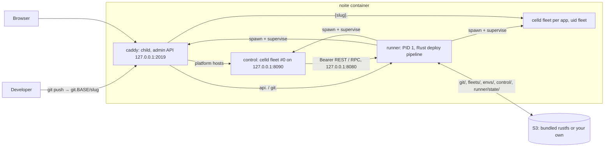

# Noite: tiny self-hostable celld PaaS

Status (2026-10-19): the alpha ships releases — `0.1.0-alpha.1` through `0.1.0-alpha.5` (2026-10-14) are published as pre-releases. One image, tenant isolation, bucket-held runner state, graceful shutdown, readiness and in-place schema upgrades are implemented and verified (`cargo build --release`, `cargo test`, `clippy -D warnings`, `bun run check`, `make e2e`, `make e2e-isolation`, the dev overlay). Scoped per-app credentials are scaffolded; no provider mints them yet. There is no v1 compatibility: installs from before the 2026-09-27 one-image change are wiped and reinstalled, while alpha installs upgrade in place ([Runner schema evolution](#runner-schema-evolution)).

Noite's promise is "your own tiny Cloudflare Workers": a person runs one install, and other people push code to it. That makes tenant code **untrusted**, and it makes the install something people deploy on Compose, Railway, Coolify or a VM with minimal effort. This file is the design record: the locked decisions first, then how each part works and the contracts it depends on. Roadmap, open questions and design history live in [ROADMAP.md](ROADMAP.md); release notes in [CHANGELOG.md](CHANGELOG.md).

## Decisions (locked)

- **Product:** full tiny PaaS — user accounts, apps, subdomains, thin deploy/build logs + status.
- **Tenancy:** one operator per install; no orgs; users own apps; per-app collaborators (`view` / `push` / `admin`). `NOITE_TENANCY=multi` (the default off a `localhost` base) treats pushed code as untrusted and sandboxes it; `single` means only the operator pushes code.
- **One image:** `ghcr.io/<owner>/noite`. `tini` → the Rust runner as PID 1, which supervises Caddy, the control UI and every tenant fleet. Every platform deploys the same image.
- **Control plane:** **Void Worker UI** (`apps/noite` — Void + `@ilha/void` routes/middleware/pages, D1 auth DB) served as celld fleet #0, plus the **Rust runner** (`apps/runner`; a Rust binary can't be a worker), which owns deploys, fleets, routing and the edge config.
- **Tenant runtime:** each app is its own celld fleet (its own bucket prefix and process).
- **Source:** stock Git smart-HTTP at `http://git.$BASE_DOMAIN/{slug}` (Basic `git` / profile API key; collaborator `view`/`push`) → runner writes tip `s3://noite/git/{slug}/refs/heads/main/{sha}.bundle` + a `MANIFEST.json` linearization point.
- **Deploy:** push to `main` (and/or tip poll / webhook) → bare mirror + checkout → build → `celld deploy` → reload.
- **Isolation:** one app = one fleet; never share `deploy/current.json`.
- **Edge:** Caddy inside the image — per-host on-demand TLS (ask-gated at `/v1/edge/tls-ask`), Host routing to the control UI (`CONTROL_SUBDOMAIN=app` in prod, bare domain in dev), `api.`/`git.` → runner, `{app}.$BASE_DOMAIN` → the app's fleet (`app`/`api`/`git` slugs reserved). The Caddyfile is static after boot (catch-all `:80`/`:443` sites); Host routing lives in a route table the runner pushes through Caddy's admin API, so app events never reload. Behind a terminating proxy (Coolify/Traefik TCP-forwarding SNI, Railway) our Caddy still issues per-host certs on demand where the proxy passes TLS through, and serves plaintext `:80` where it does not.
- **State:** one S3 bucket holds everything durable; the `/data` volume is a cache the runner can rebuild from it.
- **Effect:** prefer `Effect` / `Config` / `Schedule` / `Schema` / `HttpClient` / `Layer` over ad-hoc async.

## Architecture



### Process tree

```
tini (PID 1: reaps zombies, forwards signals)
└── noite-runner                      root; API on :8080
    ├── caddy run                      :80/:443, admin 127.0.0.1:2019
    ├── celld  control fleet #0       public 127.0.0.1:8090, internal 0.0.0.0:8091
    ├── celld  tenant fleet × N       uid fleet (10020); public 0.0.0.0:{p}, internal 127.0.0.1:{p+1}
    └── bun / sh                      builds and release, one uid per app (10030+), transient
```

- The runner owns every child's lifecycle (`host/children.rs`: restart with 1–30 s backoff; SIGTERM, then SIGKILL past the budget). There is no second supervisor and no shell entrypoint.
- The runner stays root: it needs `setuid`, `chown` and `nft`. Its children are the privilege boundary.

### Code layout

The runner layers strictly: `service/*` holds one implementation per operation; the REST handlers (`api/*`, route table `api/router.rs`) and the JSON-RPC dispatcher (`api/rpc.rs`) are peers over it, each decoding its own transport and encoding the same result — `api_error.rs` carries the shared error type and maps it onto an HTTP status or a JSON-RPC error, and no REST module imports the RPC module. `db/` is the SQLite layer in cohesive submodules (`apps`, `deploys`, `metrics`, `errors`, `events`, `env`, `credentials`, `compaction`, `alloc`) re-exported through `db/mod.rs`; `host/` is the OS/process work — `host/exec.rs` runs sandboxed children (builds, releases, runner-owned tools) while `host/s3.rs` owns the object store — and `host/metrics/` is the telemetry substrate.

The control UI mirrors that split: `src/http/` is the plain-HTTP layer (`routes/*`, over `body.ts`/`config.ts`/`sse.ts`/`session.ts`); `src/routes/` maps the URL space onto it (one file per path, via `routes/_adapter.ts`); `src/middleware/` holds the route middleware (15 s timeout, pod-host gate, D1 stamp, rate limit); `src/pages/` is the file-routed UI; `src/lib/server/*.server.ts(x)` holds every server-only module (the `.server.` suffix means server-only, each action module building its `POST /api/…` endpoints through `lib/server/api.ts`); `src/lib/ui/` the shared primitives; the feature folders `src/lib/{admin,account,auth,apps,source,app-detail,storage}/`; and `src/lib/` at the root is the shared data/pure layer (`resources.ts`, `feeds.ts`, `swr-store.ts`, `runner.ts`, `db.ts`).

Repo tooling: `docker/lib.sh` is sourced by the standalone repo scripts (`doctor`, `backup`, `restore`, `usage`, `e2e-local`), while `install.sh`/`uninstall.sh` stay self-contained because `run.sh` curls each from a raw URL. `.github/workflows/check.yml` is the reusable gate (`workflow_call`) shared by `ci.yml` and `images.yml`.

The types the two halves share are generated: every REST-boundary struct/enum derives `#[ts(export)]` and `apps/runner/.cargo/config.toml` exports them (`TS_RS_EXPORT_DIR` → `apps/noite/src/lib/runner-types`, `TS_RS_LARGE_INT = "number"` so i64/u64 stay TypeScript numbers) on `cargo test --locked export_bindings`. `lib/runner.ts` imports and re-exports the files under the UI's `Runner*` aliases (UI-only derived shapes and the D1 caps extensions stay hand-written there); the generated directory is ignored by lint/format, never hand-edited, and CI's `types` job fails on a diff.

### Ports and bucket

The operator-facing description of the published/fleet ports, the edge's Host routing and the bucket layout lives in the website docs ([How it works](apps/website/docs/02-how-it-works.mdx): Ports, Bucket layout). The contracts this design depends on:

- Fleet ports are two per app from `NOITE_FLEET_PORTS` (default `20000-29999`), claimed atomically by `db/alloc.rs::claim_ports_in` (pick-then-insert under one process-wide lock, so concurrent app/environment creates never take the same pair); exhaustion errors instead of wandering into ephemeral ports.
- `git/{slug}/` holds tip bundles from Git HTTP plus `MANIFEST.json` (`{seq, refs}`; readers resolve refs from the manifest so half-written pushes stay invisible); `fleets/{slug}/` is tenant celld (deploys, storage, telemetry); `control/` is the UI worker bundle + its D1 (accounts, invites); `envs/{slug}/{label}/` is one [preview environment's](#environments-previews) celld (its own storage and telemetry, created empty); `runner/state/` is the runner SQLite snapshots + the `owner.json` fence.
- The runner ensures bucket `NOITE_S3_BUCKET` (default `noite`) on boot, enables versioning best-effort, and uses root keys for deploy/reconcile (see [Scoped credentials](#scoped-credentials)).
- `/data` (volume `noite-data`): the live runner SQLite, git mirrors, builds, fleet working dirs, the control node's working dir, Caddy config and certificates. Everything in it is rebuildable from the bucket (certificates are re-issued).

### Image

`docker/Dockerfile` is the only Dockerfile. Stages: `celld` (the ryuzcorp/celld fork image `ghcr.io/ryuzcorp/celld:<CELLD_VERSION>`, pinned by `CELLD_DIGEST`; `CELLD_IMAGE` overrides it for a lab build of an unpublished fork tip; see `celld` below), `runner-build`, `ui-build`, `base` (bun on Debian + the `node` binary `NODE_VERSION` + jup `JUP_VERSION` from its npm tarball, checked against `JUP_SHA512`, with `npm`/`pnpm`/`yarn` shims in `/usr/local/bin`, plus the bundled npm `NPM_VERSION` and pnpm `PNPM_VERSION` (registry tarballs checked against `NPM_SHA512`/`PNPM_SHA512`, then `jup cache install`ed into a read-only `/opt/jup-bundled` store, with a build-time check that a fresh `JUP_HOME` seeded from it runs both releases with every network path dead) + `tini`, `ca-certificates`, `curl`, `git`, `awscli`, `nftables`, the `docker` CLI `DOCKER_VERSION` (signed apt repo; celld drives tenant Sandbox containers through the host engine), sidecars from `docker/install-sidecars.sh`, Caddy `CADDY_VERSION`, the `fleet` user and the reserved per-app build uid range (`BUILD_UID_BASE`/`BUILD_UID_RANGE`, pre-created in `/etc/passwd` so Node tools resolve it)), `dev`, and `noite` (the default last stage: runner binary + `/opt/noite/control/dist`). `docker/check-versions.ts` asserts each pin appears exactly once, that the access-log path matches the runner's default, that the image's passwd uid range matches `config.rs`, and that the bundled npm/pnpm pins match the runner's `BUNDLED_*_VERSION`. `awscli` stays for release commands and debugging. The compose file mounts the host engine socket (`DOCKER_SOCKET`, default `/var/run/docker.sock`) for the runner only ([Sandbox containers](#sandbox-containers)): it serves each fleet a filtered per-fleet socket and runs a relay container in the host netns, and fleets never see the real socket. CI builds `noite` for amd64 and arm64 on native runners and merges the digests (`.github/workflows/images.yml`).

## Tenant isolation

celld's internal listener carries peer traffic and an operator API (`POST /shutdown`, `POST /reload`, `POST /rebalance/pause`, `GET /state`). Every fleet node — tenant fleets and the control node — runs with a random per-fleet `CELLD_OPERATOR_TOKEN` the runner mints once, stores AES-encrypted (RUNNER_TOKEN KEK, scope as associated data, like the scoped bucket keys), and sends back as `Authorization: Bearer` on its own internal calls (`POST /reload`, the DO `?read=1` probe) and in the env of its `celld` CLI subprocesses (the in-tree CLIs that dial the node read it themselves). Liveness probes use the public `/.well-known/celld/health`, which the token does not guard. Tenant settings cannot override the token (tenant-supplied `CELLD_*` never reaches fleet process env) and Worker code cannot read it (celld builds the Worker env from declared vars only; `process.env` is empty). celld's security model assumes a trusted private network protects the listener; Noite runs untrusted Worker code in the same container, so the platform closes that network to tenant code itself on top.

Every fleet spawn starts from `env_clear()` plus an explicit allowlist (`host::fleet_env`): `PATH`, a writable `HOME` (the fleet's state dir; `/root` for the control node), `TMPDIR`, the fleet's store credentials, the `CELLD_*` knobs the runner sets, the fleet's operator token, `RUST_LOG`, the fleet's own `DOCKER_HOST` socket when sandboxing is on (a dead socket otherwise, so celld never probes well-known daemon paths), and two operator settings passed through when set (`fleet_env::INHERITED`): the custom-CA trust files (`SSL_CERT_FILE`, `SSL_CERT_DIR`) and the proxy settings (`HTTP_PROXY`, `HTTPS_PROXY`, `ALL_PROXY`, `NO_PROXY`, both cases; in `multi` celld's policed Worker fetch bypasses proxies, so they carry only celld's own store, peer and control traffic) — plus the tenant's own vars, applied first so the platform wins every key it sets. Nothing else is inherited: no `RUNNER_TOKEN`, no ambient credential chain, no operator-global `CELLD_*` (the runner warns at boot naming any it ignores). `S3_ENDPOINT` userinfo is stripped once at runner start (with a warning) for every consumer: fleets, `celld` CLIs, release commands and the control Worker.

### Tenancy mode

`NOITE_TENANCY=single|multi` (default `multi` when `BASE_DOMAIN` is outside the `localhost` family, else `single`). `host/isolation.rs::self_check` runs at boot: build uid drop, fleet uid drop, nft table installed, per-fleet cgroups set up.

- `multi`: any failed check keeps `/ready` at 503 with the reason and refuses builds.
- `single`: checks run and warn, nothing is refused; fleets and release commands use the root bucket keys only in `root` credential mode, and no egress policy is installed.

This is the honest contract for platforms that cannot provide isolation: they run Noite for one person.

### Build and release sandbox

- `exec::run_sandboxed` starts from `env_clear()`, adds `base_env` (`PATH`, `TMPDIR`, `LANG=C.UTF-8`, `CI=1`, `NODE_ENV=production`, `NO_COLOR=1`, and the per-app cache root `/data/runner/cache/<slug>`: `BUN_INSTALL_CACHE_DIR=bun/`, `JUP_HOME=jup/`, `HOME=home/`, so npm, pnpm and Yarn cache per app too — a shared `HOME` was one cache for every tenant; `JUP_ENABLE_AUTO_PIN=0`, `JUP_QUIET_ADVISORIES=1`) and the tenant's vars, drops to the app's own uid in `multi` (one per app, from the reserved range), runs in its own process group, and `killpg`s the group after every step. `run_cmd` (runner-owned tools: `git`, `celld deploy`, `aws`, `duckdb`) clears the environment too.
- Tenant vars never carry platform names: the reserved-name filter in `db/env.rs` drops `PORT`, `HOST`, `AWS_*`, `S3_*`, `CELLD_*`, `RUNNER_*`, `NOITE_*`, `BETTER_AUTH_*`, `CADDY_*`, `LD_*`, `NODE_OPTIONS`, `BUN_*` (except the cache var), `VOID_PROXY_*` (the Void proxy's per-app credentials, which only the proxy render consumes), `SSL_CERT_FILE`/`SSL_CERT_DIR` (fleet TLS trust) and the proxy vars (`HTTP_PROXY`, `HTTPS_PROXY`, `ALL_PROXY`, `NO_PROXY`, both cases — fleet/store routing; operator-only). Reserved rows are dropped with a server-side warning from fleet, build and release env.
- Worker `vars` reserve a different, smaller set (`host/worker_vars.rs`): only the runner-owned names `__VOID_PROXY`, `__PROJECT_ID`, `__VOID_PROXY_TOKEN`, `__VOID_PROJECT_SLUG`, `__VOID_EMAIL_DOMAIN`, `__VOID_EMAIL_DEPLOYMENT_ID`, plus `ISR_CACHE` and the `VOID_PROXY_*` namespace on Void apps (the runner injects that binding and consumes those settings there, and only there) — refused, the deploy fails naming the variable, whether they come from Settings or from the config's own `vars`. Every process prefix above stays allowed as a Worker var: each guards the fleet/build process environment (`PORT`/`HOST` listen, `AWS_*`/`S3_*` store keys, `CELLD_*` fleet flags, `RUNNER_*`/`NOITE_*` runner plumbing, `BETTER_AUTH_*` the control UI's sessions, `CADDY_*`/`LD_*`/`NODE_OPTIONS`/`BUN_*`/`DOCKER_HOST` runtime plumbing, `SSL_CERT_*`/proxy vars fleet TLS trust and routing), while Worker `vars` are a separate namespace no platform component reads. `BETTER_AUTH_*` in particular must stay allowed: Void auth needs `BETTER_AUTH_SECRET`/`BETTER_AUTH_URL` in Worker env, and it stays out of process env via the filter above.
- Bounds: `bun install` and the build `RUNNER_BUILD_TIMEOUT_S` (300) each, the `cloudflare.config.ts` conversion 60 s, release 600 s; `RLIMIT_NPROC` (only when dropping uid) and `RLIMIT_FSIZE`; a worktree above `RUNNER_BUILD_MAX_MB` (2048) fails the deploy.
- Worktrees are `lchown`ed to the build uid (never following symlinks) and taken back after the build. `builds/<slug>` is 0755 so bun can resolve its cwd.
- Once the tree is taken back, the deploy root must resolve inside it and its Wrangler config may not be a symlink (`deploy.rs::contained_deploy_root`): `celld deploy` runs as the runner, so a `dist` symlink into `/data` would ship platform files into the tenant's bucket. The check runs after the last tenant step (release), not when the root is picked. Symlinks further down (`main`'s imports, files in the assets directory) are not checked yet.
- **Release** (`release` in the tenant's `wrangler.jsonc`, meant for migrations) runs in `multi` with the scope's own bucket keys; where no scoped provider exists it is **skipped** (`root` mode), with a deploy-log line saying so. In `single` it runs with the scope's keys, or the root keys in `root` mode. Noite's `release` key is stripped from `wrangler.json` before `celld deploy` (celld rejects unknown keys).
- Build network stays open (package registries); the egress policy below applies to the build uid as well.

### Egress policy

Worker egress is enforced inside celld: in `multi` every tenant fleet spawns with `CELLD_EGRESS=public`, so Worker `fetch`/`connect`/outbound-WebSocket dials to loopback, private, link-local, CGNAT, ULA, multicast, reserved and metadata addresses are refused, with `CELLD_EGRESS_ALLOW=<store host:port>` as the one exception (derived from `S3_ENDPOINT`; a hostname entry re-resolves, so a moved store stays allowed). celld's own traffic — store, peers, control, telemetry, container engine — is exempt, as are dials to container endpoints the node published, node-wide: any Worker on the node may dial a published endpoint by address and port. Noite accepts that exemption: the gateway below still admits only dials to containers the connecting fleet owns, and the engine proxy keeps every other container call fleet-scoped. `single` keeps no egress policy, as before (its one tenant is trusted).

`host/netisolation.rs` installs one nft table in `multi` (it needs `CAP_NET_ADMIN`) for the per-app build range only — celld cannot police non-Worker processes. In order:

1. accept `ct state established,related` (a reject must never swallow a reply on a connection someone else opened);
2. accept DNS (udp/tcp 53);
3. accept the storage endpoint: the addresses `S3_ENDPOINT` resolves to, on its port, refreshed every 30 s (the release command runs as the build uid and holds the scope's own key, and builds hold no keys of their own);
4. reject loopback (`127.0.0.0/8`, `::1`), RFC 1918, link-local and metadata (`169.254.0.0/16`), CGNAT (`100.64.0.0/10`), and ULA/link-local IPv6 (`fc00::/7`, `fe80::/10`).

Worker dials to loopback die twice over: the egress policy refuses them, and the operator API answers 401 without the fleet's token. A single-node fleet never needs to dial loopback: Caddy dials the fleet, not the reverse. Tenant fleets additionally bind their internal listener to loopback. The control node's internal listener binds `0.0.0.0:8091` so a replacement node can reach it during an overlapping redeploy; it is token-guarded, and the egress policy additionally closes the loopback/private paths to it (a public-resolving advertise stays dialable, guarded by the token alone).

Fallback where a platform grants no `NET_ADMIN` (not built): run each fleet under `bwrap --unshare-net` with `pasta`/`slirp4netns` for internet-only egress.

### Sandbox containers

celld `containers` classes (the agent template) run as host siblings on the install's engine, fenced by celld — but celld assumes it runs in the host netns, and Noite runs it in a container on a private bridge, where celld's own fence rejects the containers' replies. Noite routes the container path around that without touching the host firewall or Docker's protections: nothing below edits host nftables/iptables, and Docker's own rules are left intact.

- **Engine proxy.** Fleets never see the host engine socket. Each fleet gets `DOCKER_HOST=unix://<per-fleet socket>` served by the runner, which forwards to the real engine only the calls celld 0.6.3 makes, validated: the peer must be that fleet's process, container creates must match celld's shape (its network mode, dropped capabilities, no-new-privileges, no privileged/CapAdd/Binds/Devices/host namespaces/port bindings, no per-class `Runtime`), app images must be exact `celld-image:<content key>` tags, every container needs CPU/memory limits no larger than celld's biggest instance type with swap equal to memory, the fence create must match celld's fence body exactly and then runs from the runner's own image (never the tenant-named one, since it gets `NET_ADMIN` in the host netns) and takes no exec or signal (celld only starts, waits for, reads and removes it), every container is labelled `noite.fleet=<install>:<fleet>` plus `noite.install=<install>` (the install tag from the store identity, so a shared engine's other installs are never swept) and per-container calls only touch that fleet's label, container exec may allocate a PTY (`Tty: true`, started the same hijacked way) and `POST /exec/{id}/resize` only rebuilds `?h=<rows>&w=<cols>` (each 1..=65535) for an exec id that fleet created here, network calls only `celld`/`celld-internal` with the member list stripped from inspects, the sockets are root-owned and capped at 256 connections each for the fleet's own process (other peers share a separate pool of 8 and only get the refusal), celld's `CELLD_CONTAINER_RUNTIME`/`CELLD_CONTAINER_DNS` are never set on fleet env (only the daemon's default runtime is supported), and `images/load` is refused outright: the deploy (run by the runner against the real engine) already pulled and tagged every image, and a fleet-supplied tar could re-tag any image on the host (another app's, the noite image, celld's fence image). A pruned image needs a redeploy. Container and exec ids are plain names only (no `%`-escapes or dot segments), so no request reaches a daemon route the allowlist never checked. Everything else is refused.
- **Gateway.** Fleet-uid TCP toward celld's subnets is redirected (nft `nat output`, `meta skuid`) to a runner listener on loopback, which reads the original destination, checks the connecting fleet owns the destination container, and relays the connection through the relay below. Cross-app sandbox dials are refused, which also closes the shared-fleet-uid hole (all fleets share one uid, so an egress policy alone cannot tell two apps apart). Only TCP is redirected: Workers have no UDP API, so in multi tenancy no tenant-aimed UDP dial can reach the bridges unredirected (celld's own UDP is its exempt resolver traffic); single tenancy (one trusted owner) has no egress policy, so there a fleet's non-TCP traffic to celld subnets is not ownership-checked. celld's bridges are IPv4-only.
- **Relay.** One helper container in the host netns (from the runner's own image, no capabilities, read-only rootfs, non-root), listening on a unix socket in the shared data volume that only root (the runner, checked by `SO_PEERCRED`) may use. Per connection it reads one `CONNECT <ipv4>:<port>` line, refuses anything outside the subnets on host interfaces `celld0`/`celld1`, and splices. Dialled from the host side, replies arrive on the host INPUT path where celld's fence admits them.
- **Lifecycle.** When a fleet exits the runner removes its labelled containers; at boot it removes every labelled container, plus the one-time alpha.12–14 leftovers (the four DOCKER-USER rules, table `inet noite_sandbox`).
- **Deploy validation.** `containers[]` with a `runtime` key is refused (the OCI runtime is operator-owned — celld lets a class override the node default); an image built from a Dockerfile in the project (`image` naming a file, or Void / Sandbox SDK 1.0's `images.default.dockerfile` + `build_context`) builds only when it runs nothing (`host/container_image.rs`): `celld deploy` runs as the runner against the host engine, so a `RUN` step would execute outside celld's fence. Allowed instructions are `FROM`, `COPY`, `WORKDIR`, `ENV`, `LABEL`, `USER`, `EXPOSE`, `CMD`, `ENTRYPOINT`, `ARG`, `STOPSIGNAL`, `MAINTAINER`; parser directives (`# syntax=` would swap in a frontend image), heredocs, build arguments in `FROM`/`COPY --from`, `FROM --platform` and unknown `COPY` flags are refused. Each registry image it reads (every `FROM` base and `COPY --from` image that is not a stage) is pulled for the nodes' platform, refused when it carries `ONBUILD` triggers (they would run during the build) or has no registry digest (an image only this engine has), and pinned by digest in the Dockerfile the runner writes (`.noite-image-<n>.Dockerfile` in the build context, replacing whatever the tree had there without following it); the Dockerfile and its context must resolve inside the worktree, the context stays under 256 MiB and 20 000 entries with every symlink in it resolving inside it, a Dockerfile reads at most 8 registry images, at most 4 entries build from a Dockerfile, and pulling and vetting them all is bounded by 600 s. An `images.default.image` naming a file is a Dockerfile like a plain `image` (celld builds any `image` naming a file). Anything that needs `RUN` is published to a registry and named instead. Void's `scheduling_policy: "durable_object"` is dropped and `images.default` becomes celld's single `image`; other policies, other image names, and both `image` and `images` are refused; and any entry is refused when `NOITE_SANDBOX` disables Sandbox containers. For a Void app with a managed sandbox the entry moves to the `noite-void-sandbox` controller config instead of normalizing in place (Void sandbox controller), and a direct registry ref there must be digest-pinned (`@sha256:` plus 64 lowercase hex) — an unpinned ref fails the deploy before anything prepares. A config that declares containers gets a 600 s deploy timeout (a first pull) instead of 120 s, and the pull is pinned to the nodes' arch (`CELLD_CONTAINER_PLATFORM`, so arm64 installs pull native images instead of celld's linux/amd64 default).
- **Operator switch.** `NOITE_SANDBOX=0` (`false`/`off`) disables everything above: no relay, no proxy sockets, fleets get no `DOCKER_HOST`. Default on when the engine socket answers. Needs a rootful engine (celld's fence needs `NET_ADMIN` in the host netns) and Docker ≥ 26 for the relay's volume subpath mount. Status rides `/ready` (`sandbox`: enabled/engine/relay/subnets/detail) and `make doctor`, informational only — it never fails readiness.

What tenants can do: declare `containers[]` with registry images or RUN-free Dockerfiles (Void's default Sandbox image is one) and reach their own containers. What they cannot: see the host engine socket or any other fleet's containers; create privileged, mounted, host-namespaced or port-bound containers; reach another app's sandbox; pick a per-class runtime; or make the install build a Dockerfile that runs anything.

Residual risks: containers run under runc, which shares the host kernel (gVisor/runsc support is the follow-up); pulled images are never garbage-collected, so disk grows with every new image; and there is no per-class runtime — every class runs under the daemon default.

### Per-fleet memory containment

Each tenant fleet runs in its own cgroup v2 child with `memory.max` (`RUNNER_FLEET_MEMORY_MB`, per-app override `app_limit.memory_mb` from Settings → Limits, applied on the fleet's next spawn) and `pids.max` 4096, so a growing fleet is OOM-killed inside its own group — contained, and the supervisor restarts it — instead of pushing every fleet toward the shared shed threshold. Swap is disabled per leaf (`memory.swap.max=0`): without it the kernel swaps a capped fleet out instead of OOM-killing it, and a tenant could push gigabytes into host swap past the cap. An OOM kill records a tenant-visible `fleet` app event and fleet log line (`fleet restarted: memory limit … MiB exceeded (Settings → Limits)`); the restart itself is the normal crash path. A fleet in its own leaf also sheds against it (`CELLD_MEMORY_SCOPE=self`): the threshold measures the leaf's working set, so an unset `CELLD_MAX_RSS_MB` sheds gracefully at 80% of the fleet's own `memory.max` before the kernel OOM-kills it, and an explicit `RUNNER_FLEET_MAX_RSS_MB` is a per-fleet-leaf threshold. Without a leaf (no cgroup grant) the knob keeps its container-wide meaning.

Why cgroups and not a celld knob: celld 0.6.2 has no hard per-fleet bound. `CELLD_V8_HEAP_LIMIT_MB` caps each isolate's V8 heap, separate from the node's memory by design, and native memory (SQLite cache, request bodies, asset cache) sits outside it entirely — so no heap value bounds the fleet process. A writable cgroupfs mount is therefore required, and it is the multi-only `docker/compose.multi.yaml` grant: `CAP_SYS_ADMIN` for one `MS_REMOUNT` of the runner's own cgroup subtree at boot (Docker mounts it read-only; the runner preserves every other mount flag), plus lifting Docker's default AppArmor mount denial. The default seccomp profile allows `mount(2)`; no other grant is needed, and `privileged` is never used. Rootless Podman cannot satisfy the grant (the remount is refused inside the user namespace, and cgroup control files stay owned by host root even under `privileged`), so Podman `multi` installs degrade loudly instead.

What the container needs (probed at boot by `host/cgroups.rs::setup`): cgroup v2, delegated `memory`/`pids`, a writable mount. Where cgroups cannot be created the runner records the reason and fleets run in the shared cgroup as before — an explicit, surfaced status in `isolation::self_check`, the boot log and `make doctor`, never a silent no-op. In `single` that is a warning; in `multi` it blocks `/ready` exactly like the missing egress policy.

The control fleet (fleet #0, the control UI) is deliberately uncapped: it is trusted platform code, not tenant code, and capping it risks OOM-killing the operator's only recovery UI during a traffic spike. It runs in the runner leaf outside every tenant group, so size the host for the install as a whole — the control node plus the capped tenant fleets — rather than per app: an install whose tenant caps sum past physical RAM relies on tenants not peaking together.

### Data directory

`isolation::harden_data_dir` runs first at boot: the runner sets umask 077, `/data`, the work dir, `builds` and `fleets` are 0755 for traversal, every other entry is 0700/0600, and the SQLite files (`-wal`, `-shm` included) are 0600. The hostile suite found the gap that motivated it: the build uid could read `noite.sqlite`.

### Hostile-tenant suite

`apps/noite/test/hostile/` is a sample app whose Worker, build script and release script attempt each attack and report JSON; `apps/noite/e2e/hostile.spec.ts` asserts every attempt failed. It runs in `make e2e-isolation` (`NOITE_TENANCY=multi`, `E2E_HOSTILE=1`) and is skipped otherwise.

| Probe | Where | Must |
| --- | --- | --- |
| `process.env` / `/proc/self/environ` for `RUNNER_TOKEN`, `AWS_SECRET_ACCESS_KEY`, `BETTER_AUTH_SECRET` | build, release | none present |
| read `/data/noite.sqlite`, git mirrors | build | EACCES |
| a neighbour's internal `/state`, `POST /shutdown` | Worker | refused |
| the runner on `127.0.0.1:8080`, the control node on `:8091` | Worker, build | refused |
| the object store root | Worker | refused or 401/403 (reachable by design, holds no keys) |
| `169.254.169.254` | Worker, build | refused |
| `https://example.com/` | Worker | succeeds |
| the neighbour app still serves afterwards | lane | 200 |

### Known limits

- The build uid is **shared**, so two concurrent builds can read each other's worktrees. Acceptable while tenants are untrusted rather than adversarial; per-build uids are the fix.
- Fleets hold [scoped bucket keys](#scoped-credentials) for their own prefix only — except on stores with no prefix-scoped keys (R2) or without the extra configuration (AWS S3 needs `NOITE_CREDENTIAL_PROVIDER=aws` and an IAM-capable key), where they hold the **root** keys as an explicit `root` mode the boot log, `/ready` and `make doctor` all name.
- Worker code and builds can reach the object store's unauthenticated surface (it answers 401/403; builds hold no keys).
- Sandbox depth is uid + env + rlimits + egress rules. A container per build (rootless Podman in the image, gVisor) is out of scope unless tenants are expected to be adversarial.
- Per-fleet memory containment: each tenant fleet runs in its own cgroup v2 child with `memory.max` (`RUNNER_FLEET_MEMORY_MB`, per-app override in Settings → Limits) and `pids.max`, so one fleet's growth is OOM-killed inside its own group — contained, and the supervisor restarts it — instead of pushing every fleet toward the shared shed threshold. Swap is disabled per leaf (`memory.swap.max=0`), so the cap cannot be swapped around. It needs the multi-only cgroup grant (`docker/compose.multi.yaml`); without it fleets share the container cgroup, and `multi` stays at 503 while `single` only warns.
- Railway does not grant `NET_ADMIN` (verified 2026-09-27: `nft` fails with `Operation not permitted`), so Railway installs run `NOITE_TENANCY=single`. Railway also wraps the entrypoint, so tini is not PID 1 there; set `TINI_SUBREAPER=1`.

## Control UI (fleet #0)

`host/control.rs` deploys and `host/control.rs::supervise` runs the control worker as a reserved fleet:

1. Wait for the bucket (`ensure_buckets`, with RustFS status diagnostics).
2. Build the worker's vars from the runner's config (`CONTROL_PASSTHROUGH`: `BETTER_AUTH_SECRET`, `NOITE_ADMIN_EMAIL`, `NOITE_AUTH_RATE_LIMIT`, `NOITE_EMAIL_WEBHOOK_URL`, `NOITE_RATE_LIMIT_RPM`, `NOITE_SMTP_FROM`, plus the URLs), dropping empty values.
3. Revision = hash of the bundle's `REVISION` and the vars; if it differs from the marker in the bucket, write `wrangler.json` into a temp copy of `/opt/noite/control/dist`, `celld deploy` it to `s3://{bucket}/control`, then store the marker. A restart with the same bundle and vars deploys nothing.
4. Spawn celld with `--listen 127.0.0.1:8090 --internal-listen 0.0.0.0:8091 --advertise <CELLD_ADVERTISE | RAILWAY_PRIVATE_DOMAIN | /etc/hostname>:8091`, `CELLD_TRUST_FORWARDED_HEADERS=1`, `CELLD_WATCH=/data/control`, `CELLD_READY_FLEET_GATE_MS=15000`, `CELLD_DURABILITY=bucket`, `CELLD_OPERATOR_TOKEN=<the control fleet's stored token>` and `CELLD_SHUTDOWN_TOTAL_MS` inside the stop budget. The advertise has to be an address a _peer_ can dial: during an overlapping redeploy the new node takes cells over from the old one through it, and a loopback advertise makes it dial itself. The token is snapshotted with the database, so the new node agrees with the old one on peer traffic. An explicit `--advertise` requires an explicit `--internal-listen` — the docs mandate the pair. The operator API on `:8091` is token-guarded; the `multi` egress policy additionally closes the loopback/private paths to it, not the bind (a public-resolving advertise stays dialable, guarded by the token alone).

The worker reaches the runner at `http://127.0.0.1:8080`. When the image has no bundle (the `dev` target), the runner skips the control child and `vite dev` serves the UI on the same address.

The whole control UI is served **cross-origin isolated**: `Cross-Origin-Opener-Policy: same-origin` + `Cross-Origin-Embedder-Policy: require-corp` on every document, module and worker script, and `Cross-Origin-Resource-Policy: same-origin` on its own assets. The TypeScript language service passes `SharedArrayBuffer` to its worker, which a browser exposes only in a cross-origin-isolated agent cluster; `require-corp` (not `credentialless`) because the UI loads no third-party subresource (avatars are initials, the docs links are plain navigations). Code mode's workspace is _not_ isolated here — it runs in its own document on the app's pod host, which carries the same three headers (see below). Production ships the policy in `apps/noite/public/_headers` as a `/*` rule: celld applies every matching rule to the asset response — documents included, since the worker's `env.ASSETS` fetch and celld's own serving share one path — and leaves the worker's non-document responses (API, MCP, SSE) untouched. The dev server applies the same three headers in `vite.config.ts` (`server.headers` for Vite's own middlewares plus a top-of-stack middleware for the responses Vite does not pass them to, such as Nodepod's asset middleware). Caddy proxies response headers unchanged, so no Caddyfile change is needed; a terminating proxy in front of Noite must pass them through.

Code mode's workspace **is a document on the app's pod host**, never code on the control origin: `app-0.preview.<slug>.<base>/noite-pod-host.html` (a string served by `src/http/routes/nodepod.ts`, `POD_HOST_HEADERS`) loads `/noite-pod-host.js` — a second entry of the control client build (`src/pod-host/main.ts`, a fixed name because the document is a string and the URL is the rendered document's only reference) — and that document boots Nodepod, the checkout and the shell. App-controlled code (install scripts, builds, terminal commands) therefore runs in the pod host's own agent cluster, with no access to the control origin's cookies, API or storage; the control page keeps the UI, the editor, the TypeScript language service and every cookie-carrying call, and talks to the document over an origin-checked `MessageChannel` (`src/lib/source/pod-protocol.ts`). The pod host serves exactly the pod's paths (`/noite-pod-host.html`, `/noite-pod-host.js`, `/__sw__.js`, `/__worker__.js`) and the `/assets/*` chunks the frame bundle loads; celld answers 404 for all of them on every other host, including the control UI's own — nothing there may create a worker or register a service worker. `@r1ck404/nodepod` (MIT with the Commons Clause, see `NOTICE`) is bundled in that entry alone, and its Vite plugin emits Nodepod's own runtime into the client build's root (`dist/client`) next to the hashed `assets/` chunks, so celld ships it with the rest of the bundle — no separate host or path.

## Edge

- Caddy is a runner child (no `--watch`, no `/load` after boot: the config is static, so there is no reload path at all; admin on `127.0.0.1:2019`). `host/caddy.rs` writes the static Caddyfile once at boot from platform config (never from app rows). App lifecycle events call `host/edge_table.rs::push_routes`, which rebuilds the route table from the DB rows, writes it atomically to `CADDY_ROUTES_PATH`, and pushes it to the edge module's admin endpoint (`POST /edge/routes`); a rejected push is logged and surfaced in `/ready`, and the previous table keeps serving. A Caddy that (re)starts loads the table file in `Provision` and converges on the next tick push. Every reload used to drop in-flight requests (Go `net/http` answers nothing when the read completes after `Shutdown` began, and closes idle keep-alive connections), so reloads on app events are gone; HTTP/1.1 keep-alive is restored.
- Upstreams are loopback: control `127.0.0.1:8090`, `api.`/`git.` `127.0.0.1:8080`, tenants `127.0.0.1:{port}`.
- Every site carries `encode zstd gzip` (celld does not compress; `text/event-stream` stays uncompressed and unbuffered), `flush_interval -1`, pooled upstreams and a 30 s `response_header_timeout`. HTTP/1.1 keep-alive is on (no `Connection: close`): with no reloads left, nothing strands a reused connection.
- Tenant, custom-domain and environment sites are **gated on fleet readiness** (active checks don't apply to dynamic upstreams): the edge module probes `/.well-known/celld/health` (503 until celld's ready gate opens) every second with a 2 s timeout, per live fleet upstream. A request for a route whose upstream is down holds until the prober flips healthy (signal-driven, 250 ms re-check backstop), giving up after 20 s (`lb_try_duration`) with a self-refreshing "starting" page, 503 + `Retry-After: 5` (the module returns a 503 error and the static `handle_errors`, gated on the route kind, renders it — never `handle_response`, so celld's own 503s from load shedding pass through). A ready fleet is proxied with no added wait; a held request is never sent, so POSTs are safe. Asleep routes skip probing (the wake hop guarantees readiness).
- Access log at `/data/caddy/access.log` (one constant, `CADDY_ACCESS_LOG`); Caddy does not roll it, the tailer (`host/accesslog.rs`) truncates after reading. Metrics do **not** come from it.
- On-demand TLS is ask-gated at `/v1/edge/tls-ask`: a certificate is minted only for a platform host, a live tenant/custom host, or a preview host of an existing app. `CADDY_AUTO_HTTPS=off` behind a terminating proxy serves plaintext `:80`.
- **Control-host denied assets:** every control-host site answers `respond 404` for the six `CONTROL_HOST_DENIED_ASSETS` (`host/caddy.rs::control_denied_assets`, derived from `PREVIEW_ASSETS` minus `/assets/*` plus the dead bridge pair) before proxying: `/noite-pod-host.html`, `/noite-pod-host.js`, `/__sw__.js`, `/__worker__.js`, `/__nodepod_bridge__.html`, `/__nodepod_bridge__.js`. The allowlist is pinned against `apps/noite/src/lib/preview-host.ts` by test. Rationale: a worker inherits the origin of the document that creates it, so any of these paths served on the control origin would let a guest app create a process worker or register a service worker inside the control UI's agent cluster, with the viewer's cookies, API and IndexedDB. `/assets/*` is excluded because on this origin it is the control UI's own bundle, served as before.
- **Pod host:** every app gets **one stable** pod host, `app-0.preview.<slug>.<base>` (`PREVIEW_LABEL` in `host/edge.rs`), not a per-session label: the pod's instance id is random per boot, so a `<instanceId>-<port>` hostname would make on-demand TLS mint a new certificate on every open, and a wildcard label would let anyone drain the CA's per-domain issuance limit. The pod boots with **path** URLs on that one origin (`previewOrigin: false`), so nothing has to interpolate an instance id into a hostname or a query. `preview.<slug>.<base>` is one extra label under the instance wildcard (no new DNS, the same on-demand TLS) and can never be a tenant host (a tenant slug carries no dot). The site serves **only** the pod's own paths from the control deployment — `/noite-pod-host.html` and `/noite-pod-host.js` (the workspace document and its bundle), `/__sw__.js` and `/__worker__.js` (Nodepod's service worker and process-worker bundle) and `/assets/*` (the chunks the frame bundle loads at runtime) — with `Service-Worker-Allowed: /` and `Cache-Control: no-cache` on the service worker, COEP `require-corp` + COOP `same-origin` + CORP `cross-origin` and `Cache-Control: no-store` on the document and its bundle — and 404s every other path, so app-controlled code never runs on the control UI's origin: it runs in the pod host document's own agent cluster, on this host. Those header ops are `defer`red: a plain Caddy `header` _appends_ to a value the control deployment already set, and a duplicated `Cross-Origin-Resource-Policy` makes Chromium refuse the frame (`net::ERR_BLOCKED_BY_RESPONSE`). `tls-ask` admits exactly that host, for an existing app only (any state: the pod runs in the browser, not the fleet). The control UI reads the origin through the `sourcePreviewOrigin` action (`apps/noite/src/lib/server/preview.server.ts`). The workspace and its Terminal share that one host.
- **Edge limits** (built from `Config::edge`, enforced by the edge module, whose `edge/routes` table carries each host's zones). Active limits answer 429 + `Retry-After` without proxying:
  - per client IP (`{client_ip}`, IPv6 grouped by `/64`): `NOITE_EDGE_RPM` (1800/min) on control, `api.`, the fallback page and each app; `NOITE_EDGE_GIT_RPM` (120/min) on `git.`;
  - per app across every client: `NOITE_EDGE_APP_RPM` (0 = none). An app overrides both in `app_limit` (NULL = default, 0 = off; RPC `limits.get|set`, admin-gated in the UI, and `limits.set` re-checks the `admin` role runner-side). Zones are named `client_<slug>`/`app_<slug>`/`client_control`…, and the module shares a zone's state by name, so an app's subdomain and custom domains draw from one budget. Limits are per minute, enforced as a sixth per 10 s sliding window. Over a limit: 429 + `Retry-After` (the access log still records each 429).
  - `servers { timeouts { read_header 10s; idle 2m } }` drops slowloris clients. No read/write deadline (event streams, uploads) and no `request_body` cap: measured behind `reverse_proxy` on Caddy 2.10, an oversized body reached the upstream or failed as a 502, which on a tenant site renders the "starting" page. Caddy 2.11's defaults stay as they are: a request body read or a response write that makes no progress for a minute (`read_body_idle`/`write_idle`, re-armed on every read and write, so a quiet event stream or a request held by the wake hop is not cut) aborts the connection, request headers past 16 KiB answer 431, and header fields whose names contain `_` or `.` are dropped before they reach an app.
  - `NOITE_TRUSTED_PROXIES` (`cloudflare` = the published ranges plus `client_ip_headers CF-Connecting-IP X-Forwarded-For`, `private_ranges`, CIDRs) → `trusted_proxies static … ` + `trusted_proxies_strict`; the control site then sends `header_up X-Forwarded-For {client_ip}`, because the worker keys its own limits on the right-most entry, which would otherwise be the proxy. With `CADDY_AUTO_HTTPS=off` on a real domain and no trusted proxies, every request comes from the proxy, so per-client zones are left out (`Config::edge_sees_clients`) and the runner warns at boot; per-app ceilings still apply.
  - No `caddy-ratelimit`: limits live in `edge/` (Go, `go test -race`), built into the image next to Caddy itself.

## Runner state

`host/state.rs` makes the volume a cache:

- **Write path:** a task polls `PRAGMA data_version` every 2 s; after a change it waits for 5 s of quiet and at most one upload every 15 s, then `VACUUM INTO` a temp file and uploads `runner/state/noite.sqlite.zst` (plus `noite.sqlite.meta.json`). Also on graceful shutdown and on `POST /v1/admin/snapshot`. The loss window on an ungraceful crash is about 22 s of API mutations while uploads succeed; while they fail, everything since the last successful upload is at risk. `last_hash`, which makes an identical snapshot skip, is recorded only after both the state object and its meta landed, so a failed meta upload is retried rather than skipped. `/ready` reports the snapshot status (`snapshot`: still the bucket owner, seconds since the last real upload, last upload error); `make doctor` prints it. Everything else is reconstructible: git mirrors from tip bundles (`host/rehydrate.rs`), fleets from the bucket, telemetry from Parquet.
- **Single writer:** `claim()` writes `runner/state/owner.json` at boot and every upload re-checks it first (`still_owner`), so a replaced runner stops uploading instead of overwriting its successor. This is a fence rather than an `If-Match` conditional write because not every S3 store supports those.
- **Boot path:** if the local database is missing, download the snapshot into `.restoring` and rename it into place before `db::connect`. Not-found starts fresh; any other error is retried and then **fails the boot**, because an empty database would overwrite the good snapshot. A local file always wins over the bucket (only local state is ever uploaded).
- Litestream was revisited (alpha.9) and declined: about a 1 s window, but the restore format is a generations layout an older image cannot read and its replication is unfenced, so it fails the non-breaking gate (no new required config, no unreadable data format, no new supervised process). A per-mutation journal of the high-value rows (apps, domains, credentials, environments) is the documented next step if operators report the residual ~22 s window hurting.

## Shutdown

On SIGTERM/SIGINT the API stops accepting, the reconcile loop stops spawning, and `supervisor::stop_all` signals every tenant fleet and the control node at once (`libc::kill`), waiting under one budget `NOITE_STOP_BUDGET_MS` (25000; each celld gets a `CELLD_SHUTDOWN_TOTAL_MS` below it so it seals its node log inside ours). Survivors get SIGKILL. Then Caddy stops (5 s), last, so in-flight requests drain through it, and then the final state snapshot is written. Compose sets `stop_grace_period: 35s`; Railway needs `RAILWAY_DEPLOYMENT_DRAINING_SECONDS=35`. The docs require the orchestrator's stop grace to exceed the node's shutdown bound. A single fleet stop (`stop_fleet`) sends SIGTERM (`libc::kill`; the documented signal, which lets celld cancel in-flight work, prove durability, release its leases and seal its node log) and waits 15 s before the SIGKILL fallback. Deletes SIGKILL the whole process group first instead: the fleet's data is wiped right after, so a graceful shutdown does only durability work the purge destroys a moment later — waiting it out would only stall the API caller past its own timeout. SIGTERM/SIGINT handling is installed before anything is spawned or uploaded (the first thing boot does), so a signal that lands at any point in the boot still runs the whole contract — fleets, control, Caddy, final snapshot — instead of the default hard exit.

## Boot order (the upgrade window)

Boot is ordered by what tenants need, and that ordering is the tenant-facing downtime of every upgrade:

1. Signal handling first, before any child exists (see [Shutdown](#shutdown)).
2. Caddy, on the Caddyfile the volume already has, so routes are live or answering the "starting" page.
3. The reconcile loop's first tick spawns every tenant fleet (all of them within ~50 ms of the container starting).
4. The REST listener binds.
5. Only then does the runner deploy the control UI (`control::ensure_deployed` uploads on any release whose UI bundle or vars changed: measured 0.66 s against a local store, more against a remote one) and start the control fleet.

Measured on a 32-core host with 15 apps: first fleet healthy 2.1 s after the container started, all of them 5.1 s. Never put the control deploy, `rehydrate_all`, or any other non-serving work in front of the fleet spawn.

## Readiness

`GET /ready` answers 200 only when all hold, else 503 with `{"ok":false,"failing":[…]}`: first reconcile done (`reconcile`); the bucket answers (`bucket: …`, cached briefly); `multi` isolation checks passed (`isolation: …`); the control fleet is healthy when the image has a bundle (`control: …`); Caddy accepted the last config (`caddy: …`). Both answers carry `credentials` — what tenant fleets hold ([Scoped credentials](#scoped-credentials)) — which is what `make doctor` prints. One check fits Compose, Railway, Coolify and Fly.

## Scoped credentials

Goal: a compromise of one fleet reaches one app.

Built (`host/credentials.rs`, `host/credentials_minio.rs`, `host/credentials_aws.rs`, table `scoped_credential`): every tenant scope — an app (`fleets/{slug}/`) or a preview environment (`envs/{slug}/{label}/`, so an environment's keys never reach production's) — holds keys minted through the store's own IAM that read, write and list only its own prefix, plus the bucket-location call SDKs make. No bucket-wide listing, no bucket HEAD: both would reveal other apps' key names. The runner keeps the root keys for its own work (deploys, purges, renames, telemetry, snapshots). Rows are AES-256-GCM with a random nonce and the scope as associated data, under a key derived from `RUNNER_TOKEN` with HKDF, so the snapshot in the bucket is not a key dump and a row cannot be replayed onto another scope. The write path refuses to store root keys.

`NOITE_CREDENTIAL_PROVIDER` (`auto` default): `minio` forces the MinIO admin-API provider (MinIO and RustFS), `aws` forces the AWS IAM provider, `root` keeps the root keys everywhere explicitly, and `auto` scopes the bundled RustFS, probes any other unknown store for the MinIO admin API once the bucket answers, and stays on root keys for R2 and AWS S3 with the reason named (see the operator table below). Keys are minted lazily at the first fleet spawn or deploy — an install that predates this gets its keys with no manual step — superseded on rename, revoked on delete (`host/purge.rs`; environment teardown revokes only the environment's key). Two consumers, two rules: `fleet_credentials` (the scope's own key, else root), `tenant_process_credentials` (the scope's own key; root only in `single`, used by release — in `multi` the release is skipped until scoped keys exist). A deleted-then-recreated slug waits for the old key's store delete before a new key is minted for the prefix.

| Store | Mechanism | Status |
| --- | --- | --- |
| RustFS | IAM user + canned policy on `arn:aws:s3:::{bucket}/fleets/{slug}/*` via its MinIO-compatible admin API (payloads use the madmin argon2id + sio-DARE encryption) | supported, verified against 1.0.0 and 1.0.3 |
| MinIO | same admin API user + policy | supported |
| AWS S3 | IAM user + inline prefix policy + access key via the IAM Query API; needs an IAM-capable key and `NOITE_CREDENTIAL_PROVIDER=aws` | supported |
| Cloudflare R2 | tokens scope to buckets, not prefixes: no long-lived prefix-scoped keys; bucket-per-app would change the bucket layout on R2 | root keys (explicit `root` mode); not planned |
| Tigris | per-bucket keys; bucket-per-app like R2 | root keys unless the store answers the MinIO admin probe |
| none of these | root keys, surfaced in the boot log, `isolation::self_check`, `/ready`, `make doctor` — loud in `multi`, never silent | explicit documented mode, not a fallback |

celld's storage contract (conditional writes, read-after-write, ranged reads) holds under the scoped keys — the LIST and multipart calls the contract needs are inside the prefix policy; celld's startup check fails loudly when a policy blocks a required call. Done when fleet keys fail `ListObjectsV2` outside their prefix, release migrations work with them (the hostile e2e suite asserts all of this), and delete revokes them with a retrying sweep.

Orphan reconcile: a mint whose row never landed (a crash inside the snapshot loss window, then a restore) leaves a live key no row names, so no row-driven revoke can ever reach it. At boot and every ten minutes the runner lists the principals it manages — `list-users` on RustFS/MinIO, paginated `ListUsers` on AWS, nothing on R2/`root` — and revokes any with no `scoped_credential` row, live or revoking. Only principals carrying this install's tag can ever be revoked: the tag is a short hash of the configured store (endpoint identity plus bucket name; bucket and region for AWS) computed at boot, so it survives DB loss — MinIO keys whose attached canned policy is exactly the tagged per-key name (`noite-<tag>-<key>` on top of the `noite` + 15 random chars shape, never the configured root key), AWS users named `noite-<tag>-…` under exactly the install's path `/noite/<tag>/` (never anything under another path, never the configured access key). Another install sharing the store mints different names and paths, so sweeps never touch each other's live keys. Keys minted before tags (alpha.8: untagged policies and path `/`) never match the filter — the safe direction: the new sweep never revokes them, while revoke/rename/delete by handle keep working for them. The listing runs without the mint/revoke lock (holding it across network I/O would stall every fleet spawn and deploy); instead each candidate is fenced — take the lock, re-check that no row names it, revoke that one key, release — so a key being minted is never judged orphaned. The fence assumes one runner owns the DB (`MUTATE` is per-process; the `owner.json` fence in Runner state). A listing or row-read failure revokes nothing, and a per-key row re-check failure skips that key for the pass. Status rides `/ready` (`credential_sweep`: install tag, seconds since the last run, total revoked, last listing error truncated to 300 chars) and `make doctor`.

## Configuration

`config.rs` is the single source of truth: one struct, defaults in one place, and no aliases (every variable has exactly one name). `Config::validate` fails the boot with a list of problems: the dev `RUNNER_TOKEN`, dev `BETTER_AUTH_SECRET` (`dev-` prefix) or the compose-default S3 keys on a `BASE_DOMAIN` outside the `localhost` family; a `BETTER_AUTH_URL` host the edge does not serve as a control host; a bad `NOITE_FLEET_PORTS` range; a malformed numeric value (the error names each var, its value and the expected form) or `< 1` `RUNNER_TELEMETRY_RETENTION_DAYS`; a stop budget under 5 s; on Railway, a draining window shorter than the stop budget. The Void proxy section (`NOITE_VOID_*`) validates the same way: SMTP mode/port/flag shapes, the email domain and allowlist entries, the AI model-map JSON (`{ "<model>": { "endpoint", "model" } }` with http(s) endpoints), the sandbox admission cap (`NOITE_VOID_SANDBOX_MAX_CONCURRENT`, a non-negative integer), and the cross-field rules (a relay host without a sender domain, `plain` without the plaintext allowance, a model map without the AI flag, an `http` AI endpoint without its allowance or past loopback) — each problem naming its var. In multi tenancy the relay and every AI endpoint must additionally be publicly reachable (loopback/private/link-local/CGNAT/ULA addresses and obviously local names fail the boot naming the var); single tenancy keeps loopback sidecars. The worker refuses default secrets off-localhost on its own too (`auth.ts::defaultSecretRefusal`). `.env.example` documents every variable and `docker/compose.yaml` gives each a default.

## Operator recovery

`docker compose exec noite noite-runner recover [--email]` (`apps/runner/src/recover.rs`) asks the control worker's `POST /internal/recovery` (runner-token gated, rate limited) for a one-time emailOTP sign-in code. The OTP sender must keep receiving `NOITE_EMAIL_WEBHOOK_URL`/`BASE_DOMAIN`/`NOITE_SMTP_FROM` (`authEnv` in `auth.ts`): leaving them out once sent every code to the console.

## Install targets

Operator guide: `apps/website/docs/self-hosting/platforms.mdx`.

- **Compose:** `docker/compose.yaml` is the whole install: one `noite` service (image `${NOITE_IMAGE:-ghcr.io/ryuzcorp/noite:alpha}`, `cap_add: NET_ADMIN, SETUID, SETGID, CHOWN`, volume `noite-data:/data`, healthcheck `/ready`, stop grace 35 s) and `rustfs` (1.0.0, API on loopback). `noite` depends on `rustfs` with `required: false`, so BYO S3 is `--scale rustfs=0` plus `S3_ENDPOINT` and keys. Every variable is defaulted, so the file boots as-is from a store or panel. Overlays: `compose.build.yaml` (build from the tree: `make up`), `compose.dev.yaml` (the `dev` target with sources bind-mounted: `make dev`), `compose.e2e.yaml` (the test lane).
- **Coolify:** the same file; the Traefik TCP router for `*.<domain>` SNI passthrough is a label on `noite`, and domains go on the `noite` service (`SERVICE_URL_NOITE_80`).
- **Railway:** one service from the image, one volume at `/data`, R2/Tigris or a `rustfs` service. Domain target port 80, `CADDY_AUTO_HTTPS=off` (Railway terminates TLS; one `*.<domain>` custom domain covers every host), `RAILWAY_DEPLOYMENT_DRAINING_SECONDS=35`, and `PORT=8080` + path `/ready` + `RAILWAY_HEALTHCHECK_TIMEOUT_SEC=600` for a healthcheck (Railway probes `PORT`; the runner never reads it).
- **Dev:** `docker/dev.sh` runs the runner under cargo-watch and `vite dev` on `127.0.0.1:8090`. `celld dev` cannot serve the UI (raw esbuild cannot resolve Void's `virtual:void-routes`), the one deliberate divergence from celld's documented dev flow. The dev base is `noite.localhost`, never bare `localhost`: the control UI, `api.`/`git.`, every tenant and every pod host then share one registrable domain, so the workspace frame is same-site (privacy browsers refuse IndexedDB and service workers cross-site — prod is same-site by construction, dev now matches). Browsers resolve every `*.localhost` host to loopback and treat it as a secure context. Every dev-only rule keys on that family through one predicate per side (`is_localhost_domain` in `config.rs`, `isLocalhostDomain` in the control UI), and an `app.subdomain` stored under a local base is rewritten to `{slug}.<BASE_DOMAIN>` at boot.
- **E2E:** `make e2e` builds the image (or `TAG=<sha>` pulls it), boots it as project `noite-e2e` with its own bucket and ports (UI :8090 through Caddy, API :8080, tenants 20000+, rustfs :19000), resets containers and volumes by label and name (podman-compose's `down -v` aborts on the first missing container), runs doctor and Playwright. `make e2e-isolation` = the same in `multi` plus the hostile suite. `E2E_KEEP=1` leaves the stack up. Two suites over the same specs: `E2E_SUITE=fast` runs the tagged pull-request gate (`@fast` on single, `@isolation` on multi, plus the setup/policy projects), and the default `release` runs every spec. On pull requests `ci.yml` runs `fast` when runtime code changed and `release` on the `e2e` label; every `v*` tag gates on `release`, and a nightly schedule runs `release` on main.
- **Backup:** `make backup` snapshots the runner, stops the stack, tars `noite-data` and `rustfs-data` with a `MANIFEST`, starts again. `make restore FROM=…` is destructive. With your own bucket, use provider versioning. Restoring an older snapshot revokes keys minted after it: their rows are gone, so the next orphan sweep treats those live fleet keys as orphans and deletes them — restart fleets after a restore (or expect one revoke-and-re-mint cycle).
- **Updates** restart the runner and every fleet with it (cold boots). Installs follow a release channel (`alpha`, the default; `stable` for final releases only; a version tag pins). `main` publishes `edge` and a short SHA, which are not install targets. A `v*` tag publishes the version image only after the e2e lanes and the CHANGELOG check pass (`images.yml`, `e2e.yml`, `docker/check-changelog.ts`), plus a GitHub pre-release; `run.sh | bash -s install --pre` installs it pinned. Marking it as a full release runs `promote.yml`, which points `alpha` (and `stable` for a final version) at that same manifest; only the latest release promotes, and `workflow_dispatch` re-points the channel by hand (rollback). Batch upgrades, and set `NOITE_IMAGE` to a version or short-SHA tag to hold back or roll back (a release that changed a schema refuses a downgrade).

## Deploy pipeline and Git

- Trigger: push fast-path (spawn after receive-pack), reconcile poll of `MANIFEST.json` + the main tip bundle, and a bearer-gated `/webhook` nudge. RustFS notifications stay off (they cannot carry a bearer).
- Pipeline: tip `.bundle` → bare mirror `repos/{slug}.git` + worktree → sandboxed `bun install` when there is a `package.json` → build: Wrangler's `build.command` (in `build.cwd`) if set, else `bun run build` when `scripts.build` exists → `cloudflare.config.ts` conversion when the tree has no Wrangler config → deploy root → optional release → strip runner keys (`release`, `build`) → for Void apps with a `durable_object`-policy `containers[]` entry, move the managed sandbox entry out of the app config (it stages the controller below) → merge Settings into Worker `vars` (a setting wins over the config's own value; reserved names and required secrets with no value fail the deploy before celld) → for Void apps (deploy root from Void's `dist/ssr/wrangler.json` output) merge the runner-owned entries (`host/void_deploy.rs`: identity vars, runner-owned `services` — the `__VOID_SANDBOX` binding when the app has a managed sandbox — the `ISR_CACHE` namespace; collisions with runner-owned names fail the deploy naming them) → stage the sandbox controller when an entry moved (Void sandbox controller: protocol check, bundle load, admission name, mapped entry) → plan `containers[]` (normalize Void's shape; refuse per-class runtimes and any entry when `NOITE_SANDBOX` is off; check, vet and pin Dockerfile images — the staged controller entry plans through the same step) → the ordered fleet deploy (`host/void_cohost.rs`): each script of the generation staged with `celld deploy --no-activate` into the same fleet bucket — the cohosted scripts first (Void apps: the proxy, plus the sandbox controller before it when one staged — each skipped when its content hash matches the stored one), the tenant app last (120 s each, 600 s for a script declaring containers, with the pull pinned to the nodes' arch) — then one `celld activate SCRIPT=VERSION...` serving the generation with a single atomic pointer write, each command retried once on infra errors (tenant failures fail at once, with no retry) — → spawn or `POST /reload` on the fleet's internal listener, whose outcome the runner parses: a `failed` adoption fails the deploy with celld's error (before, the row said Success while the old generation kept serving); an unreachable node still proceeds to the health gate, which decides → for Void apps a `migrate` step drives the generation's in-worker D1 endpoints before the deploy is marked success (below): on a redeploy against the staged generation through `celld invoke` before the activate, everywhere else after adoption. A failed release keeps the old deployment serving. Deploy logs keep a 64 KB tail.
- **Build output** (`host/build_output.rs`). When a build ran, what it produced outranks the source config: `dist/wrangler.json` first (a celld-ready config a build plugin wrote: Oxide on Vite or Rsbuild, or the older Noite templates' Void plugin), then Void's own `dist/ssr/wrangler.json` (assets in `dist/client/`), then Wrangler's deploy redirect `.wrangler/deploy/config.json` (`@cloudflare/vite-plugin`). celld 0.6 refuses the plugin's `dist/<worker>/wrangler.json` as is (about 30 Wrangler-only keys, `assets.directory: "../client"`, `.assetsignore`), so the runner writes `wrangler.json` at the nearest directory holding the Worker and its assets (normally `dist/`): the keys celld accepts (the celld key allowlist; `no_bundle` dropped so celld bundles the chunks), `main`/`assets.directory` relative to it, a D1 `migrations_dir` outside it dropped, and the plain names in `.assetsignore` deleted (a glob fails the deploy). The redirect target, `main` and the assets must resolve (symlinks too) inside the worktree; `auxiliaryWorkers` fail the deploy, and so does output sharing a directory with the source config. Void's `secrets.required` is captured before the rewrite drops the key celld refuses, and checked against settings before `celld deploy`: a required name with no setting (and no runner-provisioned value) fails the deploy listing the missing names and where to set them. Without a build, or with neither file, the source config deploys as before, so a committed `dist/` never outranks it and CLI-pushed trees are unaffected.
- **Generated config** (`host/generated_config.rs`). When neither the build output, the root, nor a subdirectory (`node_modules` skipped; it once recursed into it) has a Wrangler config, the runner writes `wrangler.json` at the root instead of failing with "no wrangler.json": a **static site** from the first of `dist/`, `build/`, `out/` holding an `index.html` (assets only; `not_found_handling` `404-page` when there is a `404.html`, else `single-page-application`), or a **Worker** from `package.json` `main` when that file exists (`nodejs_compat`, plus the static output as assets with an `ASSETS` binding). The plan is made before the release step, so a tree with nothing deployable fails early; the file is written after the worktree is chowned back, with every path re-resolved inside the project. Refused with a message: a `main` that looks like a Node server (`.listen(`/`createServer(` and no `fetch`), and a `main` inside the public output. Measured on celld 0.6: an asset-only project serves client routes with the SPA fallback; `node:http.createServer` and `IncomingMessage` throw "not implemented in celld", so Express does not run even through srvx's `toFetchHandler` bridge. Running real Node processes (srvx as the launcher) is a separate, undecided runtime.
- **Package managers** (`host/package_manager.rs`). Install and build use the project's manager: a `packageManager` / `devEngines.packageManager` pin with a version → `jup install` / `jup run build` (that exact release, bun included); else the lockfile → bun for `bun.lock(b)` (the image's bun), otherwise jup with a spec file the runner writes beside the tree (`JUP_SPEC_FILE=<work>/package-manager.json`, `devEngines.packageManager`): npm and `lockfileVersion: 9.0` pnpm name the exact releases bundled in the image (`NPM_VERSION`, `PNPM_VERSION`), older pnpm formats the major they need, Yarn `^1` for a `# yarn lockfile v1` file else latest; no lockfile → bun. jup does not infer a manager from lockfiles (unpinned, `jup install` refuses, and `yarn` alone is Yarn 4, which rejects a v1 lockfile), hence the spec. The same env reaches release, and the image's shims make `npm`/`pnpm`/`yarn` inside scripts follow the spec. npm, pnpm and bun ship in the image: at build time the Dockerfile verifies the npm/pnpm registry tarballs against their sha512 pins and `jup cache install`s them into a read-only `/opt/jup-bundled` store (an image-build check runs both bundled releases from a fresh `JUP_HOME` with every network path dead), and each deploy seeds the app's `JUP_HOME` from that store before the install step, so an unpinned project runs its manager with no registry request for the manager itself — an installed exact version needs no registry lookup. A pin of any other release still downloads that release into the app's own cache, verified against the registry signature. The build never edits `package.json`. The build cache is pruned by whole caches, largest first (a store with files missing breaks the next build; a missing one only costs a download). jup is experimental (0.x); its version is pinned with the tarball digest. Bumping a bundled release is an image release.
- **Deploy steps.** One deploy row per run: each step logs `▸ step: detail` (`fetch`, `install`, `build`, `convert`, `generate`, `release`, `deploy`, `start`, `migrate`) and its output tail (4 KB, ANSI stripped, `NO_COLOR=1` in the sandbox). A failure appends `ERROR: <step> failed` and the error tail (24 KB) to the same row, and `app.last_error` becomes `<step> failed: <first error line>`. Before this, the failure landed on a second row and the first stayed `building` until the stuck sweep.
- **`cf` CLI config.** An app may declare its Worker in `cloudflare.config.ts` (the `cf` CLI's config) instead of `wrangler.json(c)`. When neither the root nor `dist/` has a Wrangler config after the build, the runner runs `host/cf-config.mjs` with `node` in the build sandbox: `@cloudflare/config` (from the app's own `cf` dependency) loads the config and converts it with `convertToWranglerConfig`, and the script writes `wrangler.json`. Node, not Bun: the loader needs Node's module hooks and refuses Bun. celld 0.6 rejects the new `exports` key, so created Durable Objects become one `v1` migration (`new_sqlite_classes` / `new_classes`); deleted, renamed and transferred classes and other export kinds fail the deploy. `secrets` is dropped (app env vars fill that role through the Worker-vars merge; unlike the Void build-output path there is no missing-secret check on converted configs yet), a D1 binding without an id uses its name, and a DO binding to the app's own class loses `script_name`. The `cf` config has no D1 migrations directory and no `release`.
- The config `celld deploy` uploaded is stored as JSON in `app.deployed_config`, merged Worker `vars` included (plaintext values, like `app_env` itself); the storage views read it first and fall back to the Wrangler file in the pushed source. The column is never served (`serde(skip)` on the model) and the storage views read bindings only, never `vars`, so values reach no read API through it; the deploy log carries variable names only, never values. Values at rest: `app_env`/`environment_env` and `app.deployed_config` in SQLite, plus celld's deployment manifest (`deploy/<script>/<version>/manifest.json` with `plain_text` bindings) under the fleet bucket (`fleets/<slug>/`, previews under `envs/<slug>/<label>/`) — all plaintext, all operator- or owner-readable only.
- Rollback: `POST /v1/apps/{id}/rollback {sha}` redeploys a past successful sha (bundles are immutable per sha); the UI offers it on success rows.
- Tenant env: `app_env` + `/v1/apps/{id}/env` (admin-gated writes), injected into build, release and fleet env minus the reserved names, and merged into the deployed config's Worker `vars` (`host/worker_vars.rs`: every setting becomes `env.NAME`, winning over the config's own value; previews merge their overrides over the app's settings the same way). A change takes effect on the next deploy; the Settings UI says so and points at the Deployments tab's Redeploy, and the environment overrides point at the card's Redeploy. Values are write-only in the UI: `env.list` is redacted by the control worker (only `FLAG_*` rows holding `1`/`0` carry a value, for the toggles), and the `.dev.vars` download in settings is admin-only.
- Runner-provisioned settings (`host/void_deploy.rs`, Void apps only): rows the runner minted itself, marked by a `source` column (`auth-default`, `void-proxy-token`) instead of the user-written `''`. When a Void fleet has no `BETTER_AUTH_SECRET` value, the deploy mints 32 random bytes hex and stores them once per fleet — the app row for production, one override row per preview, never inherited from the app's auto-provisioned row (a preview deploy never writes the app row); the value then flows through the ordinary settings load into the Worker-vars merge, is reused on later deploys, and a user value — app or override — is never overwritten (a user-written app value still applies to previews unless overridden). Previews sharing an external `DATABASE_URL` share sessions regardless (one database). The gate is Void, not the name's presence in `secrets.required`: only `VOID_CLOUDFLARE_DEPLOY_BUILD=1` builds repeat Void's build-time auth inference there, while the auth middleware fails every request without the secret. The runner-owned merge also injects identity vars — `__PROJECT_ID` (the app id) and `__VOID_PROJECT_SLUG` (the slug) on every fleet including previews (Void scopes both per project), plus `__VOID_PROXY_TOKEN`, a random per-fleet token (32 bytes, base64url) minted once per fleet (the app row for production, one override row per preview, never inherited), and `__VOID_EMAIL_DOMAIN` when the operator configured a sender domain (Void's email client defaults `from` from it) — the tenant's `services` preserved with collisions refused, the `__VOID_PROXY` service binding to the cohosted `noite-void-proxy` script appended (the deploy runs the proxy first, so the entry never dangles) — plus the `__VOID_SANDBOX` binding to the cohosted `noite-void-sandbox` script when the app has a managed sandbox (the controller deploys first, so it never dangles either) — and `kv_namespaces: [{binding: ISR_CACHE, id: noite-isr-cache}]` (celld scopes the id to the fleet bucket, so each app and each preview gets its own ISR namespace). A tenant config named `noite-void-proxy` or `noite-void-sandbox` fails the deploy, as does an `ISR_CACHE`, `MAIL_IDEMPOTENCY` or `VOID_PROXY_*` setting, config var or binding on a Void app (other apps keep deploying those names untouched) — as does a `services` entry aimed at a runner-owned script under another binding, or a `kv_namespaces` entry aliasing the proxy's mail namespace id (`noite-void-proxy-mail`) — and as does any `__VOID_SANDBOX_*` setting or config var on any app (plus the `__VOID_SANDBOX` service binding on Void apps); the required-secrets check counts the identity vars, the proxy binding, the sandbox binding when the app has a managed sandbox, and the email domain when configured as runner-provided. Provisioned rows list like any other (values redacted in the UI as usual) but never reach build/release/fleet process env; deleting one re-mints it on the next deploy. `noite-runner void rotate-proxy-token --slug <slug> [--env <label>]` mints a fresh fleet token (never printed), applied by the fleet's next deploy — the proxy redeploys beside the app, since the token flips its content hash. A third provisioned row, `__VOID_SANDBOX_ADMISSION_NAME` (`void-sandbox-admission`), carries the secret name of the fleet's sandbox admission cell for Void apps with a managed sandbox: minted once per fleet like the token (app row for production, one override row per preview, never inherited), consumed only by the controller render — never merged into app vars — and refused as a user setting or config var like the other `__VOID_SANDBOX_*` names.
- Reload outcome: `supervisor::reload_fleet` / `reload_environment_fleet` return celld's parsed `/reload` outcome (`adopted`, `unchanged`, `failed` with celld's error, `unreachable` for transport errors and unparsable bodies), and a failed adoption fails the deploy instead of recording Success over a stale generation.
- Void D1 migrations (`host/void_migrate.rs`, Void apps only). On a redeploy the `migrate` step runs against the staged generation before the `activate` serves it: it collects the pushed tree's `db/migrations/*.sql` (Void's rule: sorted, `seed.sql` excluded; under `void.json` `sourceDir` when set, which must stay inside the worktree) and calls the staged generation's in-worker endpoints through `celld invoke` — the staged cohosted pins plus the app as `--target`, the fleet's `__VOID_PROXY_TOKEN` on `x-void-internal` through the child's environment (`--header-env`; never on argv, which every local user can read) and the body on stdin, the operator token and fleet HMAC over `CELLD_*` like `celld d1 execute` — with the same endpoint protocol: v2 where advertised (`GET /__void/migrate/capabilities` negotiated against the tree's dialect, classifier version and list hash — the runner recomputes Void's migration plan bundle byte-identically, pinned by golden vectors — then `POST /__void/migrate/app` with a fresh attempt id, reconcile-on-unknown, then `POST /__void/migrate/auth` when advertised), legacy `POST /__void/migrate` for older sqlite runtimes. Execution stays in-worker, so `_void_migrations` and the v2 attempt/lock/fence tables match Void exactly. A failed migration fails the deploy with `migration <name> failed: <error>` (names quoted, newlines flattened) and nothing activates, so the old version keeps serving; worker warnings become log lines. A prebuilt CLI tree with no `db/migrations` runs the worker's bundled migrations without the list-hash check and says so. Postgres/MySQL (a `hyperdrive` binding, no D1) is refused loudly rather than deployed with an empty database. No ordering window: traffic switches only at `activate`, after the migrations succeed, so new code never serves the old schema. Migrations are forward-only: redeploying skips applied ones (the log reports `applied`/`skipped` with the quoted names), and rolling back the code never un-applies them, so keep migrations backward-compatible with the previous release. Previews migrate their own D1 (each fleet's own bucket). On a first deploy — or when the fleet has no live node for the invoke (wiped bucket, fleet that cannot boot) — there is no previous generation to protect, so the step runs after adoption against the fleet's own listen port instead, as before; a stop in that window skips the step (redeploy to run it), and a failed post-activation `migrate` leaves the new generation serving a half-migrated schema while the deploy reads Failed (fix the migration and redeploy). Like `release` — and unlike that post-activation fallback — a failed staged `migrate` keeps the old deployment serving. The step is bounded: worker response bodies past 4 MiB fail the deploy, parsed arrays truncate at 10k migrations / 50 warnings (the log shows the first 20 warnings and names plus a count, in one write), the tree read caps at 10k files / 16 MiB per file / 64 MiB total with symlinks and special files refused, and per-request timeouts (10 s fleet capabilities probes ×3, 300 s executions, 30 s fleet reconciles ×2; staged probes and reconciles budget 60 s each for the cold pool build) cap the worst-case wall time at ~11.5 min fleet (v2 + auth) / ~15.5 min legacy — ~15 min staged (v2 + auth) / ~18 min staged legacy.
- Git hardening: `MANIFEST.json` linearization per slug, receive-pack head parsing, per-role push policy (`push` = create + fast-forward only, `admin` = anything), per-slug push mutex, double-checked manifest re-apply on reads (an unlocked fast path serves local when the newest applied seq covers the manifest; only a newer manifest takes the guard and re-reads before syncing, so a refs read overlapping a create can never apply the pre-flip read; the marker never moves backward and is forgotten on purge/slug rename, and manifest staging uses a unique tmp path per call) (`git_policy.rs`, `git_manifest.rs`). Git keys must sit under `git/`, and a manifest read error other than not-found is an error, not an empty repo.
- Auth: profile API keys (Better Auth); the runner verifies via the UI's `/internal/git-auth` and the collaborator role (`view` fetch, `push` receive).
- CLI (`packages/cli`, `@noitenow/cli`, publishable): `noite deploy` pushes a CI-built dist + `wrangler.jsonc` as a synthetic fast-forward commit over Git HTTP; reads `GITHUB_*`, writes `$GITHUB_OUTPUT`, comments on PRs via `gh`. `noite environments list|create|delete|deploy|public|vars` manages an app's environments as a thin client over the control UI's `/mcp` (the one JSON API a profile API key can reach: the runner's REST takes `RUNNER_TOKEN`), so the CLI and an agent run the same tools; the control origin is `--app-url`/`NOITE_APP_URL`, else `git.<domain>` → `app.<domain>` (the bare base on a localhost install).

## Features

### Source, branches and history

- **Where reads come from:** `host/source.rs` and `host/forge.rs` read the push mirror (`git-http/{slug}.git`), which holds every pushed branch. Each read first re-applies `MANIFEST.json` (`forge::read_mirror`), so a deleted branch can't come back from a stale local ref.
- **Refs:** without a `ref`, reads use `last_deploy_sha`, else HEAD. `ref` takes a branch name (as `refs/heads/<ref>` first), a tag or a 7–40 hex SHA. Names are validated against `check-ref-format` rules before git sees them, then resolved with `rev-parse --verify --end-of-options <ref>^{commit}`.
- **RPCs:** `source.tree`/`blob` (256 KB blob cap) plus `git.refs` (ahead/behind vs `main`), `git.log` (NUL-separated format, `--skip` paging, optional path), `git.commit` (diff against the first parent, `--root` for a root commit; 1 MB patch cap) and `git.compare` (three-dot diff; `mergeable` from `git merge-tree --write-tree`). REST mirrors live under `/v1/apps/{id}/git/…`. There is no separate "last push" diff: History's commit page shows any commit's changes.
- **Workspace checkout:** `source.tree` lists each blob with its git `sha` and `mode` (`100644`/`100755`/`120000`) beside `path`/`size`, in git tree order. `GET /v1/apps/{id}/source/archive?ref=` streams the same tree as an uncompressed tar (`git archive --format=tar`, nothing buffered) for Code mode's Nodepod workspace; the caps are checked from the listing first — ≤ 5000 files and ≤ 100 MiB of blob bytes — and an over-cap repo answers `413` with `repository too large for Code mode: …`. The listing and the archive share those caps, so `truncated` implies the archive will refuse. The browser reaches it through the control route `GET /api/apps/{id}/source/archive?ref=` (session + `view`; `Sec-Fetch-Site: same-origin` when present), which streams the runner's body through.
- **Code intelligence:** `source.bundle` serves the repo's own text sources at a ref (≤ 3000 files, ≤ 256 KiB each, ≤ 8 MiB total) plus the repo's lockfiles (`bun.lock`/`package-lock.json`/`pnpm-lock.yaml`/`yarn.lock` — the `lock`/`yaml` extensions in `BUNDLE_EXTENSIONS`), so the browser can pin package versions. The browser's language-service worker collects the bare import specifiers the open file's program needs — its own imports and those of the repository files it reaches, plus `tsconfig.json` `types`, the JSX runtime a JSX file makes the compiler resolve, and the editor's drafts, and nothing else in the repo (opening `cloudflare.config.ts` does not pull in Vite's or wrangler's graphs), reads each package's exact version from the lockfile that rides in the bundle (falling back to the range in `package.json`) and fetches that package's declarations from esm.sh (`https://esm.sh/<pkg>@<version>[/<subpath>]`, following the `X-TypeScript-Types` header, with `?raw` when esm.sh cannot build the package), recursively fetching the declarations those files import. The fetched, immutable, versioned URLs are cached in the browser, and so are the misses — a URL esm.sh does not serve is not asked for again for seven days, an esm.sh build failure (500) for an hour — so reopening the editor or switching branches is instant; the open file's own imports land before the `tsconfig`'s global declarations, so its diagnostics refresh as soon as the first of those arrives rather than when the whole graph has. A package whose fetch fails (offline, blocked, 404, private) is simply left unresolved — a `TS2307`, never a crash; an install with no network access gets no package types. The REST mirror is `/v1/apps/{id}/bundle`.
- **Writes:** every ref the server changes goes through `forge::publish_ref`: the per-slug push guard, a compare-and-swap `update-ref` (an expected old value of `None` means "must not exist"), then `after_receive`, the same bundle, manifest and TipNotify path a push takes. Callers are `git.branch_create`/`branch_delete`, browser commits (`web_commit`: commit-tree from a scratch index; up to 100 writes — `utf8` text (≤ 256 KiB, no NUL) or `base64` uploads (≤ 10 MiB decoded each, ≤ 25 MiB decoded per commit) — up to 1000 moves that re-point a blob from its parent-tree entry, and up to 1000 deletes of parent-tree files; optional `branch`/`fromSha`; a root commit when the branch doesn't exist), the import, and the PR merge. The RPC `source.commit` shares `/rpc`'s 2 MiB body cap; a commit carrying uploads (a 40 MiB body, `MAX_COMMIT_BODY_BYTES`) goes through `POST /v1/apps/{id}/source/commit`, and `POST /v1/apps/{id}/source/preview` takes the same body for a workspace snapshot (a preview is a commit onto the viewer's hidden ref) — the two routes that raise axum's `DefaultBodyLimit`.
- **Identity:** server-made commits use `git_identity::noreply`: the account name with `<userId>@users.noreply.<BASE_DOMAIN>`, passed through `GIT_AUTHOR_*`/`GIT_COMMITTER_*`.
- **UI:** Code mode is `/apps/[id]/source` (`?ref=&file=&panel=history|changes|preview`, where Preview deploys the workspace and frames its environment), `/source/commit/[sha]?ref=&file=` and `/source/compare?base=&head=&ref=` (both carry the browsed ref and, for a commit, the open file, so their back link returns to them), sharing the bar in `apps/noite/src/lib/forge/code-bar.tsx`. Pulls are their own pages: `/apps/[id]/pulls` (`?state=&skip=`), `/pulls/new` and `/pulls/[number]` (`apps/noite/src/lib/prs/layout.tsx`); the sidebar's App, Code and Pull requests items switch between them. Gated in `forge.server.ts`: reads need `view`, branch creation and commits `push`, branch deletion `admin`. A browser commit posts to the control route `POST /api/apps/{id}/source/commit` (`apps/noite/src/http/routes/source.ts`) rather than a Void JSON action: it requires a JSON content type and an `Origin` that is this site (the JSON-action transport caps every action's body at 256 KiB and reads it before auth), then the session and the `push` role, then a bounded read (40 MiB, `MAX_COMMIT_BODY_BYTES`) forwarded to the runner — a folder of uploads never has to fit an action body cap.
- **Workspace:** Code mode's workspace is the browser's Nodepod pod — a document on the app's stable pod host (`noite-pod-host.html` and its bundle), never the control UI's origin — holding the checkout, the editor, the TypeScript language service and the Terminal; anything typed in the Terminal (an install, a dev script, a build) runs there, on that host. The in-browser Preview panel and the `@noitenow/poder` bindings runtime it used have been removed. Previews are deployments now, not a browser run: see [ROADMAP: Preview environments](ROADMAP.md#preview-environments-replaces-the-in-browser-preview).

### Pull requests

- **Storage:** runner SQLite tables `pull_request` (number unique per app; one open PR per base/head pair), `pr_comment` (a line comment keeps `path`, `line`, `side` and `commit_sha`), `pr_review` (`commit_sha`, `dismissed_at`) and `app_branch_rule`. Deleting the app cascades to all of them.
- **Who does what:** the UI computes the caller's role and passes `actor` and `role`; the runner applies the rules (`service/prs.rs`). A create is refused when the head has no commits over the base (`git rev-list --count base..head` is 0), with a clear error.
- **Head moves:** wherever a branch moves (receive-pack, `publish_ref` callers), open PRs with that head get the new `head_sha`, and reviews recorded at an older commit are dismissed.
- **Counted approvals:** the latest review per reviewer, when it's approved, not dismissed, at the current head and not by the author.
- **Merge:**
  - Needs `push`; a non-admin also needs `required_approvals` counted approvals. The default `delete_branch` is off; when set, deleting the head also tears down its preview environment and that environment's storage (`env_teardown::on_refs_deleted`).
  - `merge_tree(base, head)` must be clean.
  - The squash commit is `commit-tree <tree> -p <base tip>`, authored by the PR's author with the merger as committer, then `publish_ref(base, old, new)`. A moved base is a 409.
  - A deleted head leaves the PR open in `head_missing`.
- **Protection:** `require_pr` keeps the `push` role off `main` in `git_policy::check_branch_protection` (receive-pack) and in `source.commit`; admins bypass it.
- **PR page environment card.** The pull request page shows the head branch's environment when one exists: status (deploying/running/sleeping/failed), URL (new tab), last deploy (sha, time, link to its log) and links to that environment's Metrics and Errors. With no environment it shows a Create-environment action to `push` callers, reusing the Deployments tab's flow. It follows the same live state stream as the app pages (no second EventSource on the page).

### App creation

- **Delete:** `apps.delete` / `DELETE /v1/apps/{id}` stops the fleet, purges local data and the `git/`, `fleets/` and `envs/` prefixes, then drops the row, as its own task (`service::detached`), so a caller that goes away never cancels it halfway. The call answers within 3 s, under the control plane's 5 s bound on runner calls: done (`204`, `deleting: false`), or still purging (`202`, `deleting: true`) when a slow store or a deploy holding the app's claim takes longer. From the start the app is gone from `apps.list` and `apps.get`, and a second delete reports the running one. A failed background delete is logged, leaves the app stopped and listed with `last_error`, and deleting it again retries (the control plane drops the app's grants once the call answers, so after a failed background purge the retry is the instance admin's, from the control Apps tab); the in-flight set is in memory, so a runner restart mid-delete does the same.
- **Repo at create:** `apps.create` creates both bare mirrors with `--initial-branch=main` before the row lands. Creates are serialized by one process-wide lock (`service/apps.rs`), covering the slug check, `purge_slug`, port allocation, the quota count and the insert. Without it, parallel creates could pass `RUNNER_MAX_APPS_PER_USER`, and a losing same-slug create could purge the winner's mirrors.
- **Import (`host/import.rs`):** `source: { kind: "git", url, ref?, squash? }` stores the source on `app.import_source`, sets the status to `importing` and clones in the background.
  - **The allowlist is the security boundary,** because the runner's own egress isn't covered by the nft policy. Only `https://github.com/<owner>/<repo>`, and the clone URL is rebuilt from the validated parts.
  - **Clone:** `-c protocol.allow=never -c protocol.https.allow=always -c http.followRedirects=false clone --bare --single-branch --no-tags`, with `GIT_TERMINAL_PROMPT=0`.
  - **Limits:** the clone runs in its own process group; a 500 ms poll kills the group once the scratch dir passes 500 MiB, or at the 600 s timeout.
  - **Templates** (`squash`) become one root commit "Initial commit from <owner>/<repo>@<sha>".
  - **Publish:** `publish_ref(main)`, then deploy. A failure sets `error` and `last_error`; `apps.retry_import` re-runs it (409 only while an import is actually running).
- **Templates:** `apps/noite/src/lib/apps/templates.ts` lists the templates in the one public repo `ryuzcorp/noite-templates` (`templates/<id>/`, ref `main`): `ilha-void` (Ilha + Void on Vite, writing `dist/wrangler.json`) and `agent` (Pi Durable harness in a Worker Durable Object, tools in a Sandbox container from a prebuilt image, so the fleet host needs a container engine). A template is a `{ kind: "git", path: "templates/<id>", squash: true }` import, so its folder becomes one root commit "Initial commit from <owner>/<repo>/<path>@<sha>"; the first two were verified to build, deploy and serve on celld.
- **Push to create:** on `git-receive-pack` for an unknown slug, `git_http::authorize` asks `/internal/git-auth` with `need: "create"`.
  - The UI checks the key, `SLUG_RE`/`RESERVED_SLUGS` and creates the app through `createAppForUser`, the same function as the create action. A reserved or invalid slug is a 404, the app limit a 403 with a readable message.
  - A lost race re-reads the role, and only an admin of the existing app gets through.
  - Fetches never create. The first push that creates `main` prints `remote: noite: <app url>` on side-band 1.
- **Push policy fails closed:** a receive-pack head the policy can't parse (malformed pkt-lines, a non-UTF-8 ref, no commands) is a 403 before authorization. For every non-admin, git also runs with `receive.denyNonFastForwards` and `receive.denyDeletes`. The UI's git-auth reply must name `view`, `push` or `admin`.

### MCP

- **Endpoint:** `POST /mcp` on the control UI (`apps/noite/src/http/routes/mcp.ts`, `src/lib/mcp/*`), hand-written stateless Streamable HTTP in plain-JSON mode.
  - **Methods:** `initialize` (`2025-06-18`), `ping`, `tools/list`, `tools/call`; notifications get a 202. `GET`/`DELETE` get a 405.
  - **Request checks:** browser `Origin`s other than the control site are refused, the body size is bounded, and the `MCP-Protocol-Version` header is checked.
- **Auth:** a Bearer `noite_` key verified like Git (`verifyApiKey`, scope `apps:manage`; 401 with `WWW-Authenticate: Bearer`). Tools then run through `requireAppRole`, the same gate as the server actions.
- **Tools:** apps (`list_apps`, `get_app`, `list_templates`, `create_app` via `createAppForUser`), deploys (`deploy_status`, which takes an optional `environment`, `deploy_log`), runtime (`app_logs`, `app_errors`), env vars (`env_list` masked, `env_set`, `env_unset`, all admin), the repo (`repo_branches`, `repo_tree`, `repo_file`, `repo_log`, `repo_commit`) and environments (`list_environments`; `create_environment` and `deploy_environment`, `push`; `delete_environment` and `set_environment_public`, `admin`; `environment_env_list`, `environment_env_set`, `environment_env_unset`, `view`/`push`). Every tool resolves the caller's role with the same `requireAppRole` gate the server actions use, and an environment is named by its label or its id.

### D1 table editor

One contract (`apps/noite/src/lib/runner.ts`, `local://d1-contract.md`) backs two D1 backends: the runner's `storage.d1.{tables,schema,rows,write,delete_rows}` for a tenant D1 (via `celld d1 execute --json`; REST mirrors under `/v1/apps/{id}/storage/d1/…`) and the same shape served **in-process** from the control worker's own `env.DB` (`apps/noite/src/lib/server/control-d1.server.ts`). Reads are server-side: `tables` counts rows per table in one batch, `schema` reads `PRAGMA table_info|foreign_key_list|index_list|index_info` + the `sqlite_master` CREATE text, and `rows` pages (25/50/100), sorts, filters (≤10) and searches in SQL with `LIMIT/OFFSET` and a `COUNT(*)` under the same WHERE. Identifiers come from the `table_info` allowlist and values are bound parameters (the tenant CLI path builds escaped literals instead). The UI is a Supabase-style editor on the app's Storage tab: left table list with row counts, toolbar (search/filter/sort/refresh/Insert), Data | Definition views, and a right-side row editor. Writes bind `null` to SQL NULL and `""` to an empty string; an omitted insert column takes its DDL default. The control D1 adds the admin policy: default-deny writes, redaction (masked cells; refused as filter/sort and skipped by search so a secret is not an oracle), locked columns (`user.role`, the ban columns, redacted ones), and the Users/Invites row actions.

### R2 and Durable Object browsers

The R2 and DO views share the D1 editor's chassis (`apps/noite/src/lib/storage/shared.tsx`: breadcrumb, toaster, empty state, detail-panel shell) and its full-height layout. R2 is a Supabase-Storage-style browser: the runner lists **one folder per request** — `celld r2 list --delimiter / --page` over the bucket with the folder as `--prefix`, one page (`R2_PAGE_LIMIT` folders + files) with decoded keys and the files' real `content-type` in-band, continued with the answered `--cursor` (RPC `storage.r2.list`, REST `GET …/storage/r2/{bucket}?prefix=&cursor=`). Previews and downloads read the same way (`celld r2 head` for the record, `celld r2 get` for the bytes), so nothing here encodes a key or lists the store directly. Writes are streamed and push-gated: the browser PUTs to the control route `/storage/{appId}/r2/{bucket}/upload`, which forwards the body untouched to `PUT …/storage/r2/{bucket}/object?key=`; the runner spools it to disk (64 MiB cap, matching the download cap) and calls `celld r2 put`, so the stored record is the one a Worker's `env.BUCKET.put()` writes — a folder marker is the same call with an empty body and a `/` key. Delete is one `celld r2 delete` call for 1..100 keys (`storage.r2.delete`), and both writes need the push role. Downloads re-serve the object's own media type with `X-Content-Type-Options: nosniff` and, for document types (SVG, HTML, XML), `Content-Security-Policy: sandbox`, so the proxy URL doubles as an `` and as the download link. Durable Objects stay read-only: the app's own `?read=1` response is rendered as a key/value table with per-value copy buttons, and a missing preview says the instance is not running or has no read handler. The browser commit is the other browser→control write in this shape: `POST /api/apps/{id}/source/commit` (see Source) checks a JSON content type and this site's `Origin`, then the session and the push role, before reading a body bounded at 40 MiB and forwarding it to the runner, and `POST /api/apps/{id}/source/preview` is the same write with the same gate for Deploy preview (a workspace snapshot shares a commit's payload).

### Observability (the pricing substrate)

- Fleets run `CELLD_OTEL=1` → celld writes Parquet traces (and logs) to `s3://<bucket>/fleets/{slug}/telemetry/{traces,logs}/...` (bucket sink, no collector); a preview environment's celld writes the same shapes to `s3://<bucket>/envs/{slug}/{label}/telemetry/...`. The same env comes from one helper, `metrics::otel_env`, so tenant fleets and the control fleet cannot drift: `CELLD_OTEL_FLUSH_MS` from `RUNNER_OTEL_FLUSH_MS` (30000 — dashboards lag live traffic by up to ~40 s) and `CELLD_OTEL_RETENTION` from `RUNNER_TELEMETRY_RETENTION_DAYS` (30 — one knob driving the fleet prune, the metric-table prune and the query glob floor; small installs can choose 7). A short flush REQUIRES the docs' compaction job ("Turn on the compaction job first, then shorten the flush, or queries grow slow within hours"; "celld does not compact its own files").
- **The control fleet is a telemetry source too** (`host::control::supervise` runs the same `metrics::otel_env`). celld writes `telemetry/` relative to its `--bucket`, and the control node's is `--bucket s3://<bucket>/control`, so its Parquet lands under `s3://<bucket>/control/telemetry/...` (`host/metrics/plan.rs::telemetry_prefix` owns that mapping). Compaction, ingest (incl. the idempotent chunk/watermark/replay logic), retention prune, CPU sampling of the control celld process and error grouping all treat it as one more fleet — keyed on the reserved `_control` slug with **no `app` row** (nothing that iterates apps — reconcile, Caddy, scale-to-zero, purge, backup, `list_apps` — may ever see it; `_control` is refused by `lifecycle::slug_ok`). Its node stdout is captured into the shared log ring under `_control`, and the runner serves its metrics/spans/logs/errors on the same routes (`/v1/apps/_control/...`, RPC, SSE) — shapes unchanged. `noite-runner telemetry reingest --slug _control` works. `ControlAppDetail` (`apps/noite/src/lib/apps/control-panel.tsx`) shows Overview/Metrics/Errors/Logs to a **real instance admin only, never an impersonated session**; the worker actions (`lib/server/errors.server.ts::requireTelemetryRole`) and the browser streams (`src/http/session.ts::controlStreamRefusalDecision`) re-check that same rule, and control traffic shown there includes the dashboard's own polling/SSE (real load). The dev image has no control celld (`vite dev` serves the UI), so `host::control::bundle_present` feeds `control_fleet` on `GET /v1/admin/stats`, the worker's `adminOverview` carries it, and the page shows one notice plus the control D1 instead of empty charts.
- **Compaction** (`host/metrics/compact.rs::compact_fleet`, hourly, tick step 3b), for the hour that just ended, per node directory, under each fleet's own prefix (`fleets/<slug>`, `envs/<slug>/<label>`, `control`) — one DuckDB `COPY (...) TO .../compacted.parquet (FORMAT parquet, COMPRESSION zstd)` ordered by `start_unix_us`, then the source files are deleted. Sources are deleted only after `head-object` proves the compacted file exists, so a failed copy can never lose spans; `union_by_name=true` merges an hour that spans a schema change (the docs call the schema `v0-unstable`). The current hour is never compacted. Compaction cannot change a re-read's counts: a directory holding `compacted.parquet` is read from that file alone, and a leftover from an interrupted source delete is cleaned up next pass.
- **Ingest.** The runner ingests with one **duckdb CLI** invocation per hour-chunk over every live fleet — production fleets plus every deployed preview environment: minute buckets in `app_metric`, hourly span stats in `app_span_stat`, new log lines in the `app_log` ring, error issues/hours/events — all in `metrics.sqlite` (attached, not snapshotted), every row keyed `(app_id, environment_id)` where production is `environment_id = ''`. Dashboards (`/metrics`, `/spans`, `/logs`) are SQLite reads; no DuckDB runs on any request path. A chunk is hour-aligned (the completed hours still owed, then the partial current hour), and every table is written with **replace** semantics (`db::replace_app_metric_usage`/`replace_span_stat`/`replace_app_logs`, `set_error_hour` + `refresh_error_issue_count`), so re-reading a window is exact rather than additive. CPU ms is the one accumulator (`add_app_metric_cpu`): it is sampled per tick, not replayed.
- **Watermark and fault isolation.** A failed pass never advances the watermark: `is_idle_telemetry_err` separates "the globs matched no file" (nothing to read, chunk complete) from a real error (hold the watermark, retry the chunk — exact because of the replace writers). `collect_chunk_results` (trait `ChunkPass`, so it is testable without DuckDB) retries a failed shared pass PER FLEET, so one broken fleet cannot hold the rest; a fleet that fails alone is parked by `back_off_ingest` for `INGEST_RETRY_BACKOFF` (120 s) instead of re-failing every tick. After downtime the gap is walked one hour-chunk at a time, oldest first, `commit_chunk` persisting the watermark per committed chunk, bounded by retention. `ingest_after` selects what to scan: live fleets and replay targets always (partial current hour included); a stopped fleet only while a whole hour before the cutoff is unprocessed, so a park/crash/shutdown still drains its tail within the hour it stopped in without re-reading a parked bucket forever. Deleted apps and deleted environments are absent from the fleet maps (`db::list_apps`, `db::list_all_environments`), and an environment teardown purges its rows, watermark and compaction marks first.
- **Windows and globs.** Aggregation lags the flush by 10 s (`AGG_LAG_US` = flush + 10 s): the window stops past the flush interval, so every minute bucket it names has closed and nothing is counted twice across ticks. Query globs are hour-scoped: the window names only the hour directories it spans (`<prefix>/telemetry/{kind}/<node>/<yyyy>/<mm>/<dd>/<hh>/…`, `prefix` = `fleets/<slug>`, `envs/<slug>/<label>` or `control`, node left a wildcard so an earlier node's history still aggregates), never the whole retention — the docs' "a query that reads one day therefore touches only that day's files", and DuckDB opens every file a glob names. The ingest derives each row's fleet key from that path (`fleets/([^/]+)/` for production, `envs/([^/]+)/([^/]+)/` → `{slug}.{label}` for an environment, else the control prefix → `_control`), so a chunk stays exact per source in one shared scan. Glob expansion uses `glob()` before `read_parquet` (celld writes no file for an empty batch, and one unmatched glob used to fail the whole pass, which then counted as idle and skipped every fleet's rows). Both architectures run DuckDB `1.5.6` (`docker/install-sidecars.sh`): arm64 had stayed on 1.2.1 because DuckDB renamed the asset to `linux-arm64` in 1.3, and 1.2.1 cannot `strftime` a TIMESTAMPTZ, so no ingest pass bound there.
- **Reality checks.** Requests = span `name='celld.fetch'` (verified 1:1 against traffic); errors = the `ok` flag; latency/queue = `duration_us`/`queue_wait_us`; CPU = `/proc` process sampling of the celld subtree (OTel has no CPU signal).
- **Error tracking** (`host/errors.rs`, Errors tab). The same ingest pass groups failed spans by their `error` text (celld writes `rejected: Name: msg [at f (worker.js:1:2) <- …]`; a DO failure appears on the cell span _and_ re-wrapped on its parent, hence `count(DISTINCT trace_id)`) and picks up `ERROR …` log bodies that carry a stack (`console.error(err)`, rejected `waitUntil`). Issues/occurrences/hour buckets live in `metrics.sqlite` (`app_error_*`), keyed `(app, environment)` like everything else, so each environment folds its own issues and production stays separate. Request context joins by trace id: tenant sites stamp `traceparent` from `{http.request.uuid}` and `log_append traceID` (`caddy.rs` `TENANT_TRACE`; **not** Caddy's `tracing` directive — it always dials an OTLP exporter on :4317), and the access-log tail keeps trace → request in memory (`RequestIndex`, 15 min). The tail runs before the ingest each tick; a span ingested before its access line was tailed stores its occurrence without a request and is marked pending, and the tail backfills the row when the line lands — so a re-read never has to rewrite it.
  - **Sentry envelope ingest (phase 2).** DSN `https://<key>@<control-host>/<n>` (`<n>` = stable per-app numeric project id; stock `@sentry/core` rejects non-numeric ids, so the slug cannot serve). `POST /api/<n>/envelope/` on the control UI: key from `sentry_key` (query) or `X-Sentry-Auth`, CORS open, 200 KB cap post-gzip, per-key rate limit; keeps `event` items only, drop-only 200 for transactions/sessions/replays/profiles/attachments/client reports. Runner RPCs `errors.ingest` (events → `errors::record`, fingerprints match phase 1) + `errors.ingest_key`/`rotate_ingest_key`; `source` is `browser`/`sdk`; occurrences carry URL (query stripped), release, environment. Wrong key or unknown project is the one refusal; everything else is 200.
  - **Source maps (phase 3).** After a successful deploy, `host/sourcemaps.rs::store_deploy_maps` keeps that deploy's maps at `<fleet-bucket>/maps/<sha>/` (`fleets/<slug>/` for production, `envs/<slug>/<label>/` for an environment, so purge and rename carry them): `worker.js.map` is the map `celld deploy --sourcemap` wrote for the app deploy (project-root-relative sources; the deployed bytes are identical with or without the flag) — for a `no_bundle` entry, the entry's sibling map celld collected — chained through the build's own entry map when one exists (a pass-through for collected maps, whose sources are already original) — a missing map file (asset-only and Python projects, which celld warns about and writes nothing for, and a `no_bundle` entry without a sibling map celld accepts) means no worker map — and every client `*.map` the build emitted under `client/`, named by a `manifest.json` with the assets dir. No maps are generated for client code and nothing publicly served changes; per-map and per-deploy (64 MiB) byte caps bound a hostile build. `service::errors::get` symbolicates each occurrence against its own deploy's maps — exact asset-path match, original positions clipped like raw frames — through a bounded in-memory cache (8 MB per map, 32 MB total, negatives included) with per-read fetch/frame budgets; stored frames and fingerprints stay raw, so grouping never changes. Map dirs outside the last ten successful deploys' shas are pruned; older occurrences render raw.
- **Restart and replay.** Runner restarts resume telemetry from the persisted watermark (`metric_watermark` in `metrics.sqlite` on `/data`, an hour boundary, one row per fleet key — an app's slug, an environment's `{slug}.{label}`, `_control`) and the compaction watermark, both written per committed chunk; a crash re-reads the last chunk, which the replace writers make exact. `noite-runner telemetry reingest [--since <RFC3339|duration>] [--slug] [--no-wait]` (top-level `telemetry.rs`, like `recover`) queues a replay row in `main.telemetry_replay`; the tick rewinds the target fleets' watermarks once and clears the row when all have reached the current hour. The 0.1.0-alpha.3 migration (version 4) queues that replay once for every upgrading install to recover rows the pre-alpha.2 ingest dropped.
- **API/UI.** Every observability read takes an optional environment (`GET /v1/apps/{id}/metrics?hours=24&environmentId=`, same for devices/paths/refs/spans/version/errors/logs/events, RPC and SSE alike): absent or empty means **production only** — which changes the old meaning, where production was the only data and the filter would have been a no-op. The control stream (`/api/apps/{id}/metrics/stream?hours=&environmentId=`) serves 24 h, 7 d or 1 month (720 h) (`?r=` on the Metrics tab picks it); `MetricsCard` shows hourly bars and a spans table. The Metrics and Errors tabs carry an environment picker (Production first, then environments), deep-linkable by the Deployments tab's `?env=` convention; logs scope through the Deployments tab's environment groups; role gates are unchanged (`view` reads). MCP `app_logs`/`app_errors` take the same optional environment. Custom events stay app-scoped (their writes carry no environment identity), so the Events tab has no picker. The PR page shows the head branch's environment card (status, URL, last deploy, links to its Metrics/Errors) when one exists, else a Create-environment action for `push` callers.
- **Keep responses lean.** Dashboards read persisted aggregates (minute buckets, span stats, log ring) instead of recomputing DuckDB per viewer; only persist what pricing needs plus the bounded log ring.
- Never spawn celld for undeployed apps (crash-loops on missing `deploy/current.json` — guard lives in `app/loop_.rs`).
- **Pricing** (not built): bill on requests + `duration_us` and/or CPU ms.

### Instance telemetry

Opt-out, anonymous, one event per instance per day, sent by the runner straight to PostHog's HTTP capture API (`POST https://eu.i.posthog.com/i/v0/e/`, with the write-only project key compiled in) — no SDK and no browser tracking. `instance_heartbeat` carries counts and closed values only: `version`, `celld_version`, `arch`, `tenancy`, `storage`, `apps`, `apps_running`, `apps_sleeping`, `deploys_24h`, `deploys_failed_24h`, `users` (a bucket: `1`, `2-5`, `6-20`, `21+`, `unknown`), `install_age_days`, `uptime_hours`; the body always sets `$geoip_disable` and `$process_person_profile: false`, and never carries domains, hostnames, names, emails, IPs, slugs, bucket names or endpoints. State is the runner's `instance_setting(key, value)` table (schema step 5: `install_id` = random UUID v4 created on first boot, `installed_at`, `telemetry_enabled`, `telemetry_last_sent_at`), snapshotted into the bucket with the rest of the DB. Schedule: first attempt 10 min after boot, then hourly, sending when the last success is absent or ≥ 24 h old; a failure is logged once and retried on the next tick, never on the boot or request critical path. `NOITE_TELEMETRY=0`, `DO_NOT_TRACK=1` or a local base domain (`localhost`, `*.localhost`, `*.local`, `*.test`, `*.internal`, an IP literal) disables it and locks the setting with a reason. `telemetry.get|set` (REST `GET|PUT /v1/admin/telemetry`, bearer-gated) return a `TelemetryStatus` whose `preview` is the exact body the next send would post; the `/account` Admin section is the operator surface. The operator-facing description is [Telemetry](apps/website/docs/self-hosting/telemetry.mdx).

### Update check

Opt-out, anonymous, one request per instance per day, made by the runner straight to GitHub's public release list (`GET https://api.github.com/repos/ryuzcorp/noite/releases`, fixed URL, fixed `noite-update-check` User-Agent, no auth) — no SDK, no browser, no request-path work. The runner compares the running `NOITE_BUILD_VERSION` against the newest **promoted** release on the install's channel (drafts ignored always; GitHub pre-releases are not yet promoted and never count; a final release only hears about finals, an alpha about every promoted release; `dev` and SHA builds never notify) with semver ordering, and remembers the result in the runner's `instance_setting(key, value)` table (`update_check_enabled`, absent = on; `update_check_last_at`; `update_check_result`). Admins see a dismissible per-version banner in the control shell (admins only, fetched with the page's normal data loading — never a new EventSource) linking the release notes; `NOITE_UPDATE_CHECK=0` (also `false`/`off`) locks the check off and wins over the UI toggle. `instance.update_status` (and `GET /v1/admin/update`) reports `{ enabled, current, latest, checked_at, notes_url }` (the `set` reply adds `checking: true` when it triggered a background check, so the card can show "Checking…" without waiting on GitHub), and `make doctor` prints the check state with the newest release seen.

### Invite-only registration

The worker D1 has an `invite` table (`code`, `createdBy`, `usedBy`, `usedAt`, `revoked`, `note`, `createdAt`); `lib/server/invites.server.ts` owns mint/redeem/list. The first account registers with no code and becomes `admin`; every later one needs a single-use code (12 characters, unambiguous alphabet, `ABCD-EFGH-JKLM`). Redemption is one `UPDATE … WHERE usedBy IS NULL AND revoked = 0`, so one code admits one account. Each new account gets `INVITES_PER_USER = 2` codes. Members see theirs on `/account`; admins mint 1–50 and revoke in the control app's Invites tab (`/apps/_control`); the signup form shows the field once `GET /api/invite/status` says the instance is past its first account. Email-code sign-in (`emailOTP`) is recovery for existing accounts only (`disableSignUp`), so it cannot skip the gate. It lives in the worker because accounts do; the runner never sees registration.

### Collaborators and passkeys

- Grants live in D1 `app_collaborator` (`view`/`push`/`admin`) and are the only access below instance admin: the creator gets an `admin` grant on create and can be removed like anyone else while another admin remains (no creator fallback).
- Inviting an email writes a pending `collaborator_invite` row (unique per app + email), never a grant. The invitee sees it on `/apps` after signing in with that address and accepts or declines; the inviter cannot tell whether the address has an account. Deleting an app drops its grants and invitations. Slug lookups use the runner's `apps.get_by_slug`.
- The account page lists, adds, renames and deletes passkeys; adding to a signed-in account skips registration provisioning. Recovery by emailed code lands on `/account` to add a new one.
- The admin home is the control app's detail page (`/apps/_control`): Users (search, pages of 25, role, ban, delete, impersonate; deletion refused for yourself or an account that is the only admin of an app), Apps (all owners: start/stop/delete), Invites, and the control D1 table editor (linked from Overview) alongside the control plane's telemetry tabs.

### Custom domains

`app_domain` claims keyed `(hostname, app_id)` with `status` (`pending`/`verified`), a per-claim `token` and `verified_at`, exposed as `GET/POST /v1/apps/{id}/domains`, `POST …/domains/verify`, `DELETE …/domains/{hostname}` and RPC `domains.list|add|verify|remove`. Every call carries the caller's app role (`?role=` on REST, `role` on RPC; `view` to list, `admin` to mutate), enforced runner-side — the control UI resolves and passes it, so a bearer alone cannot mutate domains. `lifecycle.rs::hostname_ok` validates (lowercase DNS shape, ≥ 2 labels, no wildcard/IP/port/path); platform hostnames and `CONTROL_EXTRA_HOSTS` are refused. Ownership is proven by a DNS TXT record at `_noite-challenge.<hostname>` containing the claim's token (the same shape as ACME's `_acme-challenge` DNS proof, under our own label so a Noite proof can never be mistaken for a certificate-issuance record). The runner resolves TXT through an injectable resolver (a trait; hickory against the system resolver in production, a fake in tests; a missing system resolver fails every lookup readably as unavailable) under a 10 s bound per Verify call — one lookup per explicit Verify call, no background polling. Several apps may hold a pending claim for one hostname; the first to verify wins, after which other pending claims for it are dropped and new claims are refused (409), so a tenant can never squat a hostname it does not own (a concurrent loser maps the partial-index violation to the same 409, structurally). At most one verified row per hostname is enforced by a partial unique index. Only verified domains are routed (Caddyfile), certified (`tls-ask` mints nothing for pending names) or resolved by the fallback page, and only while the app is deployed and running. In `single` tenancy a claim verifies immediately (one trusted operator owns the DNS); in `multi` it stays pending until its TXT proof resolves. Pre-verification rows are grandfathered as verified (schema version 10), because they are live sites.

### Limits

- `RUNNER_MAX_APPS_PER_USER` (10), enforced in the runner on `apps.create`, so API keys cannot bypass it.
- `RUNNER_FLEET_MAX_RSS_MB` (0 = unset: celld's default) → `CELLD_MAX_RSS_MB`, set on a fleet only when non-zero. Fleets in their own cgroup leaf measure the leaf (`CELLD_MEMORY_SCOPE=self`), so unset sheds gracefully at 80% of the fleet's own `memory.max` and an explicit value is a per-fleet-leaf threshold (503 + `Retry-After` instead of the kernel OOM-killing the fleet); fleets without the cgroup grant share the container's cgroup, so there it stays a container-wide shed threshold. The old default of 512 closed every fleet's ready gate (`memory_headroom=false`) and refused cells with `CapacityExhausted` once the container as a whole passed 512 MB: permanently in dev (vite + workerd ≈ 2.7 GB), and while the control fleet booted in prod (fixed 2026-09-28); `RUNNER_FLEET_IDLE_EVICT_S` (120) → `CELLD_IDLE_EVICT_S`; `RUNNER_FLEET_LEASE_TTL_MS` (60000, at least 10000) → `CELLD_TTL_MS` on every fleet and the control node: celld renews its node lease at a third of it and self-fences (exit 3) once it passes, so with celld's 10 s default a store or disk stall over about 7 s restarted every fleet at once (seen on a 2-vCPU prod host while a Sandbox container started, reproduced by pausing RustFS for 25 s) and each restart reaped the fleet's Sandbox containers; one node per app has no peer to hand cells to, and the cost is that a fleet killed without a handoff waits up to the TTL to own its cells again; `RUNNER_FLEET_ASSET_CACHE_MB` (64) → `CELLD_ASSET_CACHE_BYTES` per fleet, in `CELLD_ASSET_CACHE_DIR=<fleet state dir>/asset-cache` (celld's default `/tmp/celld/asset-cache` is shared by every node and created 0700 by the root control node, so tenant apps with assets crash-looped on EACCES until 2026-09-30).
- `RUNNER_FLEET_MEMORY_MB` (512) is the default per-fleet `memory.max` in MiB; `app_limit.memory_mb` (Settings → Limits, RPC `limits.set`, admin-gated in the UI and re-checked runner-side — the call carries the caller's app role and anything but `admin` is a 403 — applies on the fleet's next spawn) overrides it per app, capped by `RUNNER_FLEET_MEMORY_MAX_MB` (default: the default cap, so a tenant can only lower its cap in `multi`; the runner refuses a higher override and clamps rows stored before the ceiling). An OOM kill at the cap restarts the fleet and records a tenant-visible `fleet` event and fleet log line. `limits.get` stays role-free like the other runner reads.
- Sizing rule for the default: the largest per-fleet peak RSS measured across the release suite, times two for headroom, rounded up to a clean number, never below 512. Per-fleet peaks come from the multi lane, where containment is active (the single lane shares the container cgroup, so only its container-wide high-water exists); tenancy does not change fleet footprints. Measured 2026-10-22 in CI multi release run 39763680663 (`fleet-peaks.json` in the `playwright-report-multi` artifact): max per-fleet peak 256 MiB (`oom-fleet`, pinned at its deliberately small test cap — the largest organic peak was 38 MiB, `ilha-void`), so × 2 = 512 MiB and the default stays 512.
- `RUNNER_FLEET_LOG` (`error,celld=warn`) → the fleet's `RUST_LOG`, so celld's warnings reach the per-app log view.
- `RUNNER_FLEET_DEPLOY_POLL_S` (300) → `CELLD_DEPLOY_POLL_S` (the runner POSTs `/reload` after every deploy, so the fleet poll only covers a missed reload). `RUNNER_BUILD_CACHE_MB` (512) caps the persistent per-app build cache at `/data/runner/cache/<slug>` — `bun/`, jup's package-manager store `jup/`, and `home/` (the build's `HOME`, where npm/pnpm/Yarn cache): it survives deploys, is pruned by whole caches largest-first after each deploy, is chowned to the build uid, and is deleted with the app.
- Machine routes (`/webhook`, ingest) refuse bodies over 256 KiB; the control `/webhook` proxy requires the runner token and forwards only the body and content type. `/health` reports the build id (git sha stamped by `vite build`).
- Edge rate limits: see [Edge](#edge).
- Rate limits in the control worker: better-auth's per-client budget for `/api/auth/*` (`NOITE_AUTH_RATE_LIMIT`, 600/min, keyed on the right-most `X-Forwarded-For` entry, the one Caddy appends; the worker collapses the header to it first) and a worker limiter per route class `auth`/`invite` (`NOITE_RATE_LIMIT_RPM`, 600/min, 429 + `Retry-After` before better-auth or D1). `0` disables either. The raw-port e2e lane raises both.

### Scale to zero (idle sleep)

An app with no requests for a day stops costing anything, and the next request brings it back without the visitor noticing.

- **Sleep sweep.** A scheduled job in the runner (`host/sleep.rs`, every `RUNNER_SLEEP_SWEEP_S`, default 3600 s) puts an app to sleep when all of these hold:
  - it is deployed, desired `running` and awake;
  - it has no request in the last `RUNNER_SLEEP_AFTER_H` hours (default 24; `0` disables the feature).
- **What counts as activity.** Activity is the newest of:
  - the last minute bucket with requests in `metrics.app_metric` (celld `celld.fetch` spans, i.e. real requests);
  - the app's last wake (`app.woke_at`);
  - its last deploy. So a fresh deploy or a manual start gets a full window before it can sleep.
- **Asleep is not stopped.** `desired_state` stays `running` (the owner's intent). Sleep is its own column, `app.asleep_since`, and `status` reads `sleeping` for the UI. A stopped app never sleeps or wakes, and stopping an asleep app clears the flag.
- **Going to sleep** (per-app transition lock), in this order:
  1. mark the app asleep;
  2. rewrite the Caddyfile so its sites wake on demand;
  3. stop the fleet with the normal SIGTERM drain. A request that arrives mid-transition therefore already takes the wake path.
- **Waking is invisible.** An asleep app's tenant and custom-domain sites keep routing to its port, preceded by `forward_auth` to the runner's `GET /v1/edge/wake`. Caddy holds the original request, body included, while the subrequest runs. The runner:
  1. resolves the app from `X-Forwarded-Host` (tenant slug or custom domain, as `edge_fallback` does);
  2. clears the flag and sets `woke_at`;
  3. spawns the fleet immediately;
  4. waits until `/.well-known/celld/health` answers 200, bounded by `RUNNER_WAKE_TIMEOUT_S`, default 120 s, which covers celld's ready gate;
  5. rewrites the Caddyfile back to the plain proxy;
  6. answers 200. Caddy then proxies the held request as if the app had never slept. There is no "starting" page: concurrent requests wait on the same wake (per-app lock), and only a failed wake answers an error (503).
- **Bounded cold starts.** At most `RUNNER_WAKE_CONCURRENCY` (4) apps cold-start for requests at once (a semaphore around steps 2–4); a wake queues for a slot and the health wait inside one `RUNNER_WAKE_TIMEOUT_S` budget. A flood across many asleep apps therefore starts them a few at a time instead of all together.
- **What else counts as activity.** A deploy of an asleep app (push, rollback, web commit) wakes it first. TLS ask treats an asleep app as live, so custom-domain certificates keep renewing.
- **Cost of the choice.** The first request after a quiet day waits for a cold fleet start: celld boot plus its ready gate, typically a few seconds. Everything after it is unaffected.

### Environments (previews)

One environment per branch, at `<label>.<slug>.<base>`; `main` is the app itself, never an environment. The `environment` table (schema v8) carries `id`, `app_id`, `label` (unique per app; `host/env_label.rs` sanitizes the branch, ≤ 40 chars, `preview`/`app-0` reserved, suffixed on collision), `kind` (`branch` | `workspace`), `git_ref` (`refs/heads/<branch>` or `refs/previews/<userId>/<branch>`), `created_by`, `fleet_bucket`, `listen_port`/`internal_port`, `status`/`desired_state`/`asleep_since`/`woke_at`, `last_deploy_sha`/`last_deployed_at`, `public`, `last_error`; `environment_env` holds per-environment overrides, and `deploy.environment_id` (NULL = production) scopes deploy rows. Deleting an app cascades both. Role gates are enforced in the runner (`service::environments::require`): `view` to read, `push` to create/deploy and set variables, `admin` to delete and to flip public; the control UI resolves the caller's role and passes it, and a missing role is a refusal.

- **Bucket.** `s3://<bucket>/envs/<slug>/<label>` (`Config::envs_uri`), not a `fleets/` sibling: a slug may itself contain `--`. An environment is its own celld fleet, so its first deploy creates new D1 databases, Durable Object state and R2 buckets (migrations run as on any first deploy); production's are untouched, and nothing seeds an environment (there is no D1 dump/restore primitive).
- **Deploy target.** `deploy::DeployTarget` = `Production` | `Environment(Box<Environment>)`: the bucket, the ref `materialize_bundle` checks out, the deploy row's `environment_id` and the `last_deploy_sha` dedupe all come from the target. An environment deploy never writes `app.fleet_bucket`/`app.*_port`/`app.last_deploy_sha`/`app.status`/`app.deployed_config`. Builds stay serialized by the per-app `AppLock` and share its cache.
- **Fleet identity.** ProcMap/log-ring key `"{slug}.{label}"` (`supervisor::env_fleet_key`), state dir `envs/<slug>/<label>`, spawn/stop/reload through `supervisor::*_environment_fleet*`; `stop_orphan_fleets` resolves both key shapes, and the live log ring is per environment.
- **Refs.** `list_refs` carries `refs/heads/*`, `refs/tags/*` and `refs/previews/*`, so a preview ref gets a tip bundle and a manifest entry, while `uploadpack.hideRefs`/`transfer.hideRefs` (`forge::hide_preview_refs`, set at init and on a first preview write) keep hidden refs out of clone/ls-refs: branch lists, pull request heads and `resolve_ref` never see them. `after_receive` returns every moved ref's tip, and a deleted branch deletes its environment (`env_teardown::on_refs_deleted`).
- **Workspace preview.** `source.preview` snapshots the workspace's files, moves and deletes as one commit on the branch head at `refs/previews/<sanitize_label(userId)>/<branch>` (`service::environments::preview_ref`), writes its bundle like a push, creates the (user, branch) environment on first use (caps checked) and deploys it. One environment per (user, branch): a later snapshot redeploys the same one, so its storage survives between previews.
- **Edge.** `host/edge.rs::parse_env_host` reads `<label>.<slug>.<base>` (the labels the pod host owns are refused here, exactly as the labeler refuses to mint them); `tls_ask` admits an existing environment's host, so each environment host gets one on-demand certificate — the caps bound issuance per domain. `host/edge_table.rs` emits one route per environment on its fleet port with the tenant route's readiness hold, wake-on-request hop and rate-limit zones (`client_<slug>`/`app_<slug>` are shared with the app by name), plus `Cross-Origin-Resource-Policy: same-site` so Code mode can frame it.
- **Access gate.** A members-only site (the default) puts `forward_auth /v1/edge/env-gate` in front (`host/env_gate.rs`): no `__noite_env` cookie → 302 to `//<control>/api/env-auth?env=&app=&return=`, where the control UI checks its session and the app's `view` role and mints a 60 s token (`environments.grant`); `/v1/edge/env-auth` (the site's `handle /__noite/auth*`, served by the runner, never proxied) verifies it, sets the host-only, `HttpOnly`, `SameSite=Lax` `__noite_env` cookie (12 h) and 302s to the rooted return path. The runner's two redirects carry no scheme (scheme-relative, then a path): behind a TLS-terminating proxy Caddy only sees http, and an `http://` hop inside Code mode's frame on an https page is mixed content the browser refuses. Both values are HMAC-SHA256 over the runner token, domain-separated, so the gate adds no secret to configure or leak; both paths are public in `auth.rs` (Caddy calls them without a bearer). Inside one `route` the gate reads the cookie and a `map`+`request_header` strip removes `__noite_env` from the `Cookie` header (Caddy cannot edit one cookie with `header` ops), so the app never sees it. A gate that admits an asleep environment wakes it, so a gated site needs no second wake hop and an unauthenticated visitor never spawns a fleet. `environments.update {public}` (admin) drops the gate for one site.
- **Lifecycle.** Environments scale to zero like apps (`host/sleep.rs`: the sweep sleeps an environment when its own request activity (its ingested request buckets) plus its deploy/wake/creation floor are older than the threshold; the gate and a public site's wake hop call `wake_environment`). `purge_slug` and `rename_slugged` cover `envs/<slug>/` and each row's `fleet_bucket`; `loop_.rs` and the reconcile tick keep env fleets and refs in step and sweep workspace previews past `RUNNER_ENVIRONMENT_TTL_H` — branch environments live until their branch or their row goes. Caps `RUNNER_MAX_ENVIRONMENTS_PER_APP` (5) per app and `RUNNER_MAX_ENVIRONMENTS` (25) per instance are checked at create, so no API surface can exceed them.
- **Telemetry.** An environment's celld writes `envs/<slug>/<label>/telemetry/...`, ingested exactly like production: rows key under `(app, environment)` where production is `environment_id = ''`, watermarks and compaction marks key on the `{slug}.{label}` fleet key, and the Metrics and Errors tabs scope by environment with a picker (Production first, then environments, `?env=` deep-links) while logs scope through the Deployments tab's environment groups. Deleting an environment purges its telemetry rows, watermarks and compaction marks, so a reused label starts clean. Environment deploys keep source maps under their own prefix and symbolicate like production. Custom events stay app-scoped: their writes carry no environment identity, so the Events tab is always app-wide.

### Void platform proxy

Void apps reach platform services (`revalidate()`, `sendEmail()`, `ai.*`) through the `__VOID_PROXY` service binding. Noite serves that binding with a runner-owned Worker script, `noite-void-proxy`, cohosted in each Void app's fleet next to the tenant app (celld `services` resolve within the fleet bucket only, so one fleet's proxy is unreachable from any other fleet or from the public internet). The proxy is self-sufficient: fleet-local KV bindings plus direct internet egress (SMTP via `cloudflare:sockets`, AI providers via `fetch`). It never calls the runner. Source: `apps/void-proxy/worker.ts` (the celld `main` entry: the router plus the default export) plus the whole `apps/void-proxy/src/` tree it imports (`env.ts`, `isr-keys.ts`, `auth.ts`, `revalidate.ts`, `ai.ts`, `email/validate.ts`, `email/smtp.ts`, `email/send.ts`) — dependency-free modules embedded in the runner with `include_str!` (the image build copies them where the includes resolve; `compose.dev.yaml` bind-mounts them for `make dev`); celld bundles the `.ts` entry with esbuild at deploy, so there is no build step. Tests (`*.test.ts`), `test-helpers.ts` and `sockets.d.ts` never ship.

**Deploy order and cohosting** (`host/void_cohost.rs`, one reusable mechanism for every runner-owned script — the `noite-void-sandbox` controller rides it too). Each Void deploy runs its cohosted scripts first (lowest order first: the sandbox controller when one stages, then the proxy; the proxy renders `wrangler.json` per fleet: name `noite-void-proxy`, the embedded `worker.ts` as `main`, the `ISR_CACHE` binding on the same namespace id as the app's plus the fixed-id `MAIL_IDEMPOTENCY` binding, vars per the Env contract below), then the tenant app last, then the one `/reload` whose outcome fails the deploy on a refused adoption. Every `celld deploy` runs the same invocation into the same fleet bucket (a script declaring containers gets the 600 s timeout, like the app); previews render their own scripts into their own bucket. A script whose content hash (sources plus rendered config — per-deploy container-image paths excluded, plus the image digest composite for the controller — with secret values substituted by their hashes so a rotation redeploys it) matches the hash stored for that fleet (`void_cohost_hash`, keyed per app and per environment) is skipped — steady state is one app deploy. Every `celld deploy` in the sequence — cohosted scripts and app alike — retries once on infra errors; a twice-failed deploy carries both attempts' errors. A runner upgrade picks the new embedded proxy up lazily, on each fleet's next deploy. Each render goes to a fresh owner-only temp project holding the fleet's secrets in plaintext; it is removed on every path (success or failure), so failed deploys leave nothing on runner disk, and the error carries names only. The fleet token is ensured once per deploy and threaded into both the app merge and the proxy render, so a rotation landing mid-deploy cannot split them.

**Failure windows.** Tenant-code failures are pre-pointer (celld bundles before writing anything) and fail at once, with no retry. Every script stages with `celld deploy --no-activate` (moving no pointer) and one `celld activate` serves the generation with a single atomic pointer write, so a failed stage — cohosted or app — runs no activate and the previous generation keeps serving; there is no window where the pointer names a half-deployed fleet. Every command retries once on infra errors (idempotent; tenant failures, matched on celld's own error strings, never retry); anything else fails loudly; the next successful deploy heals. Stored cohost hashes name activated content (written only after the activate commits).

**Operator config** (`NOITE_VOID_*`, validated at boot): the sender domain (`NOITE_VOID_EMAIL_DOMAIN` → `__VOID_EMAIL_DOMAIN`, proxy and app), the SMTP relay (`NOITE_VOID_SMTP_HOST` — email is enabled iff set — plus optional port, `starttls`/`implicit`/`plain` mode and the plaintext allowance), the admission allowlist (`NOITE_VOID_EMAIL_ALLOWLIST`, empty fails closed), and AI (`NOITE_VOID_AI_ENABLED` plus the `NOITE_VOID_AI_MODELS` map; `http` endpoints need `NOITE_VOID_AI_ALLOW_PLAINTEXT=1` and must be loopback sidecars — anything else fails the boot). In multi tenancy the relay and every endpoint must be publicly reachable: the proxy runs in the tenant fleet and fleet egress rejects loopback/private destinations, so non-public hosts (loopback/private/link-local/CGNAT/ULA addresses, obviously local names) fail the boot naming the var, and the loopback-`http` allowance is inert there. Unset means email sends and AI calls answer 501; `/revalidate` needs no operator config. The per-app credentials (`VOID_PROXY_SMTP_USERNAME`, `VOID_PROXY_SMTP_PASSWORD`, `VOID_PROXY_AI_API_KEY`) are ordinary Settings rows — inheritable, per-environment overridable, served with values like any other setting (single-operator premise; the control worker redacts values for the UI) — that the deploy splits out before the app merges: they only ever reach the proxy render, never app vars or process env, and any other `VOID_PROXY_*` use on a Void app fails the deploy naming it.

Portions of the worker (ISR key helpers, the `/email/send` validation chain, MIME `From:` pinning, the provider envelope codec, the path-traversal guard) are ported from the Void project (MIT License); Noite-specific adaptations (KV idempotency instead of SQL admission, SMTP transport instead of the `send_email` binding, a static native provider map instead of the AI gateway) are marked inline in the module where they live.

**Env inputs (all plain-text vars except the two KV bindings):**

| Name | Required for | Meaning |
| --- | --- | --- |
| `__PROJECT_ID` | everything | Noite app id; `projectId` in every body is pinned to it |
| `__VOID_PROXY_TOKEN` | everything | per-fleet random token, constant-time equality |
| `__VOID_PROJECT_SLUG` | `/email/send` | app slug; the `from` local part is pinned to it |
| `__VOID_EMAIL_DOMAIN` | `/email/send` | operator mail domain; the `from` domain is pinned to it |
| `ISR_CACHE` (KV) | `/revalidate` | same namespace id the app uses for ISR |
| `MAIL_IDEMPOTENCY` (KV) | `/email/send` | fixed-id namespace for idempotency records |
| `VOID_PROXY_SMTP_HOST` | `/email/send` | relay host; email is enabled iff set |
| `VOID_PROXY_SMTP_PORT` | `/email/send` | relay port (defaults: `starttls` 587, `implicit` 465, `plain` 25) |
| `VOID_PROXY_SMTP_MODE` | `/email/send` | `starttls` (default) \| `implicit` \| `plain` |
| `VOID_PROXY_SMTP_ALLOW_PLAINTEXT` | `/email/send` | `plain` is refused unless exactly `1` |
| `VOID_PROXY_SMTP_USERNAME` / `VOID_PROXY_SMTP_PASSWORD` | `/email/send` | per-app credential (proxy-only setting, never in app vars); absent = no AUTH |
| `VOID_PROXY_EMAIL_ALLOWLIST` | `/email/send` | comma/whitespace-separated exact addresses or `@domain` exact domains (subdomains do not match); empty = fail closed |
| `VOID_PROXY_AI_ENABLED` | `/ai/*` | `501` unless exactly `1` |
| `VOID_PROXY_AI_MODELS` | `/ai/run` | JSON map `{ "<model>": { "endpoint", "model" } }` |
| `VOID_PROXY_AI_API_KEY` | `/ai/run` | per-app key for the operator endpoint (absent = keyless endpoint) |

**Endpoints** (all POST + JSON except `GET /health`; other methods are 405 `{error:"method not allowed"}`, unknown paths 404 `{error:"not found"}`, bodies capped at 1 MiB, 8 MiB for `/ai/*` and `/email/*`): `GET /health` (no auth; `{ok, bindings}` booleans); `/revalidate` (`{paths?, all?}` → `{ok, purged}`; KV purge across all deployment ids, since the request carries no deployment id — `all` also clears the `void-isr-hosts/` registry; every purged KV key also deletes its html and json `caches.default` entries (Void's edge-URL derivation, ported — the base key and every variant; best effort per entry, so a degraded Cache API never fails the KV purge), which the proxy reaches because fleets run `CELLD_CACHE_SCOPE=deployment`); `/email/send` (Void's response contract verbatim: `{ok, ids}` with one entry per recipient, partial `{ok:false, deliveries}`, whole-send `{ok:false, error:{code}}` with Void's codes; sender pinned to `<slug>[+tag]@<domain>` plus the MIME `From:` pin; every recipient must parse as one addr-spec (dot-atom `local@domain`, no quoted-strings or display names — malformed is a whole-request 400 `INVALID_TO`) and admission matches the parsed pair (exact address, or exact domain for `@domain` entries); idempotency is KV-based, 24 h TTL, same-key/same-digest replays the recorded outcome, same-key/different-digest is 409 `IDEMPOTENCY_CONFLICT`); `/ai/provider` (full port: static native base-URL map, tenant provider key with native auth-header defaults, `json`/`text`/`base64`/`form+file` envelopes, relative-path guard, upstream status passthrough with `{error}` mapping, byte passthrough for streams); `/ai/run` (operator model map → `POST {endpoint}/chat/completions` for `{messages}` inputs, endpoint-native response returned untranslated, SSE passthrough for `stream:true` on success (upstream errors keep their status, never 200 SSE), loud 501 `{error:"model not available", model}` when unmapped and 501 for non-chat input shapes); `/ai/models` and `/ai/toMarkdown` (501 `{error:"not available"}` — no faithful implementation without Workers AI); `/email/relay` (404 tombstone). Skipped entirely: `/d1|kv|r2/*` (dev-only remote mode, never the service binding) and `/email/verify-receipt` (travels with deferred inbound work → 404 in v1).

**Security rules.** Isolation is structural (same-fleet-only binding resolution), not token-based; the token only authenticates the caller to its own fleet's proxy. **No operator-wide secret may ever be put into proxy vars** (proxy vars are plaintext in the fleet bucket manifest): no shared SMTP password, no shared AI gateway key — per-app credentials only, which keeps a compromised fleet to its own app. Auth failures are Void's shapes: missing credentials 400 `{error:"projectId and aiToken required"}`, mismatch 403 `{error:"invalid project token"}`. The KV idempotency check-then-act races under _concurrent_ identical sends (double-send possible; no KV conditional-write surface exists to close it) — sequential repeat/conflict are exact, and the race is documented here as accepted at-least-once for v1. SMTP `AUTH PLAIN` then `LOGIN`; plaintext SMTP only with the operator allowance; the SMTP client refuses any command line carrying CR/LF before writing it; per-command timeouts under a 50 s batch deadline; anything ambiguous after the DATA bytes leave is `outcome_unknown`, never a silent success.

### Runner schema evolution

From the alpha an install is upgraded in place. Two stores, one rule: a shipped schema is never edited, only extended.

- **Runner SQLite.** `apps/runner/schema.sql` is the idempotent shape of a fresh database, applied every boot. `schema_version.rs` holds `SCHEMA_VERSION` (1 = the alpha baseline) and `MIGRATIONS`, one `(version, sql)` per step, applied in order before `schema.sql` inside one transaction that also sets `PRAGMA user_version`. An unstamped database that already has tables is the baseline. A database stamped newer than the binary is refused at boot with a message (run the newer image or restore a backup); there are no downgrades. A change edits the `CREATE` in `schema.sql` and appends a step; steps qualify tables as `main.<name>` (a bare `DROP` would resolve into the ATTACHed `metrics.sqlite`), and `schema.sql` itself never ALTERs or DROPs. `metrics.sqlite` is derived and unversioned: its own `ensure_environment_telemetry` runs once per boot, adding `environment_id` and rebuilding each telemetry table's primary key around it by copying every row (`production` rows keep `''`), so an upgrade preserves production history and needs no replay; a downgrade across it is unsupported, like every other downgrade.
- **Control D1.** paranorm's `createMigrator(schemaHistory)` with its `paranorm_migrations` ledger. The shipped `_version: "1.3.0"` schema is frozen; the next change is a new `defineSchema` with a higher `_version` appended to `schemaHistory` (ledger ids are positions). Before migrating, `assertLedgerCompatible` refuses a ledger that is newer than the build, or whose entry was written by a different schema.

### Void sandbox controller

Void apps with sandboxes reach them through the `__VOID_SANDBOX` service binding: without it, Void's runtime throws `SandboxUnavailableError` under the vars Noite injects. Noite serves that binding with a runner-owned Worker script, `noite-void-sandbox`, cohosted in each Void app's fleet next to the tenant app (celld `services` resolve within the fleet bucket only, so one fleet's controller is unreachable from any other fleet or from the public internet; its `fetch()` answers 404). `getSandbox` returns the controller cell's Durable Object stub directly (the DO-stub shape): Void's client only ever calls `capability.invoke(op, args)` on it, so no Worker-held capability wrapper exists. Source: `apps/void-sandbox/worker.ts` (the celld `main` entry: the service plus the `SandboxController` and `NoiteSandboxAdmission` DO exports) plus the `apps/void-sandbox/src/` tree it imports (`meta.ts`, `protocol.ts`, `env.ts`, `admission.ts`, `controller.ts`). Unlike the proxy, the controller has npm dependencies, so the image build compiles a fixed single-file bundle ahead of time (`void-sandbox-build` stage: `bun install --frozen-lockfile` from the package's own `bun.lock`, then `bun run build` → `dist/worker.js` + `dist/meta.json`), shipped at `/opt/noite/void-sandbox/` in the image. The bundle builds from the pinned `void` npm version (exact pin + lockfile; `docker/check-versions.ts` guards the agreement with `src/meta.ts`) with `cloudflare:*` and `node:*` left external for the deploy bundler and the runtime. Tests (`*.test.ts`), `test-helpers.ts`, `test-setup.ts`, `build.ts` and `workers.d.ts` never ship. The runner reads the bundle from disk at deploy time (`VOID_SANDBOX_BUNDLE_DIR`, default `/opt/noite/void-sandbox`; a dev checkout points it at its built `apps/void-sandbox/dist` via `compose.dev.yaml`) and verifies it against its own digest before anything deploys it.

Portions of the runtime (the lease/admission/activity/alarm structure, the stream guards, `getSandbox` validation) are adapted from the Void project (MIT License; the adapted files carry "adapted from" notices marking every Noite change — see NOTICE), and the bundle embeds `void/_sandbox-container` plus `@cloudflare/sandbox` (Apache-2.0, see NOTICE).

**Env inputs (all plain-text vars except the two DO bindings):**

| Name | Required for | Meaning |
| --- | --- | --- |
| `SANDBOX` (DO) | everything | `SandboxController` cells, one per sandbox id |
| `__VOID_SANDBOX_ADMISSION` (DO) | everything | `NoiteSandboxAdmission` cells; controller-internal, never bound into the app |
| `__VOID_SANDBOX_ADMISSION_NAME` | everything | secret name of the admission cell (at least 32 base64url characters, minted once per fleet by the runner): celld derives a named id from the name alone, so a fixed name would be a public address; missing or short fails every admission closed |
| `__VOID_SANDBOX_MAX_CONCURRENT` | everything | max concurrent live sandboxes (default `"4"` when the var is missing — the runner always renders it; `"0"` admits nothing; a present-but-unreadable value fails closed to `0` and admits nothing) |
| `__VOID_SANDBOX_SOURCE` | nothing | `void <version> / bundle sha256:<hex>` recorded at deploy; debug only |

**Behaviors.** Admission is a fleet-local DO (`reserve`/`started`/`heartbeat`/`stopped` with generation fencing: a stopped generation is never re-admitted, `stopped` always succeeds so teardown works after cap changes); denials use Void's exact `VOID_SANDBOX_concurrency`/`VOID_SANDBOX_unavailable` strings so the client maps them to `SandboxLimitError`/`SandboxUnavailableError`. An abort reaches the process: `exec()` forwards the caller's AbortSignal to celld, which sends SIGKILL on abort (celld 0010/0015, workerd semantics — an already-aborted signal refuses with its reason before spawning). PTY sessions work: `exec` takes `pty: true` or `{ cols, rows }` (celld patch `0006`), the wire `isPty` reports the terminal, and `resize` resizes it. The sandbox shim (`/usr/local/bin/sandbox-shim`) must be baked into the image — custom images `FROM` (or `COPY --from`) a shim-carrying image; a missing shim fails container start with that contract. Direct port fetches refresh the idle deadline like `invoke` does. Direct `execProcess`/`initializationOutput` calls heartbeat like `invoke` ops (setup-time execs run under the setup's own verdicts), and concurrent `beforeStart` calls serialize per cell so a superseded start's reservation is released instead of orphaned. The lease machine (30 s heartbeat/alarm, idle reap) is Void's unchanged.

**Protocol.** The bundle speaks `controllerProtocol` 2. Before `celld deploy`, the runner refuses any Void app with a sandbox entry whose `void` major differs from the bundle's, with Void's exact message ("Managed Sandboxes require an updated Void runtime. Upgrade void, rebuild the app, and deploy again."); minor/patch drift inside the major is wire-compatible. The rule lives in `apps/void-sandbox/src/protocol.ts` (pinned by tests); the runner ports it verbatim. The deploy records the app `void` version, the bundle `void` version + sha256, and the protocol.

**Tenant-reachability review gate.** Under the DO-stub shape every method on `SandboxController` is tenant-reachable, including `protected` ones and void's TypeScript-`private` `setup` (runtime-visible); `controller.test.ts` asserts the exact 16-method + 4-accessor set and fails on any addition — a new method needs a tenant-safety review before the list is updated, never a silent append. Admission stubs never cross to the app: the only object the app ever holds is its own cell stub. Known deviation: a module-cached stub stays usable across app requests (DO stubs are durable-addressable; workerd would throw) — the client never depends on the throw.

**Render contract (for the deploy pipeline).** Entry `worker.js`; DO bindings `SANDBOX` → `SandboxController` and `__VOID_SANDBOX_ADMISSION` → `NoiteSandboxAdmission` with matching migrations; vars above; the app's `durable_object`-policy `containers[]` entry moved to the controller config (image through the existing vet, `max_instances` backstop equal to the admission cap, stable container name); `nodejs_compat` flag (the bundle imports `node:os`); `__VOID_SANDBOX` service binding injected into the app config. `dist/meta.json` carries `{ "void", "controllerProtocol", "bundleSha256" }` for the deploy record. Dev checkouts without an image build run `bun run build` in `apps/void-sandbox` to produce `dist/`; tests run `bun test` in the package dir (which preloads the `cloudflare:workers` stub — the suite runs the real classes over the real `void` base).

**Deploy glue** (`host/void_sandbox.rs`). A Void app has a managed sandbox when its built config carries a `durable_object`-policy `containers[]` entry (more than one fails the deploy); non-Void apps keep the unmanaged path untouched, and Void apps without the entry deploy no controller. The entry moves out of the app config before the merges (the app keeps its `SANDBOX` binding + migration), and the controller stages after them: the protocol check (a mismatch fails with Void's exact message and provisions nothing), the bundle load, the fleet's admission name (the `void-sandbox-admission` provisioned row, minted once per fleet, injected only into the controller render), and the mapped entry — controller class, stable container name `noite-void-sandbox-v1`, `instance_type` dropped (ignored in v1), `max_instances` set to the admission cap (`NOITE_VOID_SANDBOX_MAX_CONCURRENT`, default 4; `0` admits nothing) — written to a staging dir. The staged entry plans through the existing `plan_containers` + `container_image` vet (the `NOITE_SANDBOX` gate refusing a sandbox app where containers are off; Dockerfile paths absolutized against the app root so the staging plan resolves exactly what an app-root plan would), with an unpinned registry ref refused up front; the prepared image reaches the controller config by absolute path (the cohosted project deploys from a different dir than the staging one). Deploy order is controller, proxy, app, each staged with `celld deploy --no-activate` (each cohosted script skipped when its content hash matches the stored one — the controller's covers the bundle, the rendered config with the per-deploy pinned path excluded, and the image digest composite of pinned Dockerfile + build context, so an image change re-stages it while identical content in another build dir skips) and served together by the one `celld activate`; previews get their own controller. The controller stage gets the 600 s container timeout and the same one infra retry as every other fleet command. The deploy records the app `void` version, the bundle `void` version + sha256, and the protocol — the admission name never reaches the log, and a tenant `noite-void-sandbox` script name fails the deploy like the proxy's.

## celld alignment

The docs at https://celld.dev/docs/ are the source of truth. What Noite relies on:

- **Tenant fleets:** `--bucket s3://<bucket>/fleets/<slug> --endpoint … --region … --listen 0.0.0.0:<p> --internal-listen 127.0.0.1:<p+1> --advertise 127.0.0.1:<p+1>`, `CELLD_WATCH` under `/data/fleets` (owned by the fleet uid), `CELLD_DURABILITY=bucket` (a single-node fleet has nobody to send to; the `fleet` posture needs two nodes before any proof completes), `CELLD_DEPLOY_POLL_S=5` (a push goes live faster; the runner also calls `POST /reload`), `CELLD_ESBUILD`, `CELLD_OPERATOR_TOKEN` (the fleet's stored token, Bearer-guarding the internal listener), `CELLD_EGRESS=public` + `CELLD_EGRESS_ALLOW=<store host:port>` in `multi`, `CELLD_MEMORY_SCOPE=self` with a cgroup leaf, `CELLD_CACHE_SCOPE=deployment` (the fleet's scripts share one `caches.default`, like a Cloudflare zone, so the cohosted Void proxy deletes the app's ISR L1 entries on `/revalidate`), and the telemetry and limit settings above.
- **Control node:** see [Control UI](#control-ui-fleet-0). An explicit `--advertise` requires an explicit `--internal-listen`; the advertise must be peer-dialable, never loopback.
- **Removed variables** are rejected at startup (`CELLD_OTEL_SINK`, `CELLD_OUTPUT_GATE`, `CELLD_STORAGE_PROBE`, `CELLD_PACED_HANDOFF`, `CELLD_SHUTDOWN_DRAIN_MS`, …); Noite sets none.
- **Storage qualification:** celld qualifies S3, R2, GCS, Tigris and Azure Blob; the store must provide conditional writes, read-after-write and ranged reads, and celld checks the contract at node start. RustFS is **not** qualified: it passes celld's check and stays the zero-config default, but production should use a qualified store.
- **Compression:** celld does not compress assets; Caddy does (`encode zstd gzip` on every generated site).
- **Assets:** only accepted top-level `wrangler` keys (unknown keys fail the deploy — hence stripping `release`); `assets` uses `directory`, `binding: ASSETS` (not auto-injected) and `not_found_handling: single-page-application`. celld serves assets with `max-age=0, must-revalidate`, so `apps/noite/public/_headers` marks `/assets/*` immutable for a year.
- **R2 objects are plain objects under `<fleet>/r2/<bucket_name>/<key>`.** The five content headers are real object headers and the rest of the record (`customMetadata`, cacheExpiry, checksums, storageClass) travels as one JSON value in the `celld-r2` user-metadata entry. celld percent-encodes the stored key (`%`, the set `\{}^`[]"<>~#|*?`, controls and every non-ASCII byte; space stays literal; an empty segment becomes `%`), and nothing here mirrors that codec: `host/storage/r2.rs`lists, previews and downloads through`celld r2 list --page`/`head`/`get`, which answer decoded keys with the record in-band.`celld r2 get|head|put|delete|list`reads the fleet bucket directly with no running node; reads and writes both go through it so the stored record is the one a Worker's`env.BUCKET.put()`writes (verified 2026-10-06 on a throwaway celld 0.6.1 node: an object written by`celld r2 put --content-type`read back through a Worker's`env.BUCKET.get()`with its bytes and`httpMetadata.contentType` intact, including keys with spaces, non-ASCII (`é`) and empty segments (`a//b`, `photos/`); a bare S3 PUT stores neither the encoding nor the record).
- **Operator surfaces:** `make doctor` checks `GET /.well-known/celld/health` on the control node and runs `celld diagnose --read-only --listen 127.0.0.1:0` inside the container (diagnose binds a listener of its own, and its default `:8080` is the runner's), next to `celld node health`. `celld diagnose --read-only` is the documented fleet check (node leases, peer probes, advertised addresses). Diagnose authenticates from its env, so doctor reads the control token from the root-only `<work-dir>/control-operator-token` the runner rewrites on every control spawn — inside the container shell, so the token never appears on the host command line; without it the peer probes fail closed with 401s.
- **celld 0.6.0:** `compatibilityDate` is required (`2026-09-01` in `apps/noite/cloudflare.config.ts`, the UI's Worker config: `vite.config.ts` converts it with `@cloudflare/config` and the build emits `dist/wrangler.json`); no `export const` in a main module; wasm modules as `{ wasm: bytes }`; `transactionSync()` takes no callback; R2 keeps empty key segments distinct. Durable Object facets migrate to their own SQLite files on first open, which with `fleet` durability requires stopping the whole fleet first; every install path here replaces the node rather than overlapping two.
- **celld 0.6.1:** a rolling update from 0.6.0. Log records carry the level in `severity_text`/`severity_number` and the body holds only the message; the ingest puts the `ERROR `/`WARN ` prefix back (`host/metrics/ingest.rs::ingest_all`), so logged-error tracking and the Logs tab read the same text as before. Not adopted: `CELLD_MAX_ASSET_FILE_BYTES` stays at its 25 MiB default; Python Workers are not detected by the build step.
- **celld 0.6.2:** a rolling update from 0.6.1 (a rollback rolls too). `celld deploy` bundles exactly as 0.6.1 did: `run_esbuild`'s flags, the CommonJS-builtin banner and `BARE_NODE_BUILTINS` are unchanged at the v0.6.2 tag (the runner mirrored those flags in a shadow bundle then; it no longer does — `celld deploy --sourcemap` writes the worker map itself, so bumps re-verify nothing); the telemetry Parquet schema is unchanged too. A forwarded Durable Object `stub.fetch()` rejects when the owner's handler fails (as a local one does), a WebSocket response to a request without `Upgrade: websocket` is a `TypeError` and a 500, and `self` is defined in Worker isolates. Not adopted: epoch GC (`CELLD_LTX_RETENTION_SECS`) now runs under `bucket` durability as well, but it deletes on the strength of list-after-write consistency, which celld documents only for its qualified stores, and the bundled RustFS is not one. It stays unset, so a cell's bytes still grow with each activation.
- **celld 0.6.3:** a rolling update from 0.6.2 (a rollback rolls too). `run_esbuild`'s flags, the CommonJS-builtin banner and `BARE_NODE_BUILTINS` are byte-identical to 0.6.2 (verified at the v0.6.3 tag; the last bump that needed the check — the runner's shadow bundle of those flags is gone, replaced by `celld deploy --sourcemap`). Security: rustls 0.23.46 (GHSA-2mjx-qc3c-rqvc) and outbound TLS distrusts the compromised eMudhra CA chain. A node refuses to acquire a cell whose ownership record is missing while its LTX is still in the bucket (logs `celld ownership record lost`, at most every 10 s per cell) instead of starting it empty — a restore that lost the record stays failed and visible rather than silently empty.
- **celld** ([ryuzcorp/celld](https://github.com/ryuzcorp/celld)). Upstream ships only security fixes from 0.6.x on, so Noite runs the fork: upstream denoland/celld at 0.6.3 plus the fork's patches (see its FORK.md), published as `<version>-ryuzcorp.<n>` with SLSA provenance attestations and pinned by digest in `docker/Dockerfile` (`CELLD_VERSION`/`CELLD_DIGEST`, the single source). To bump: tag the fork's line tip, wait for publish, copy the pin lines from the publish summary into `docker/Dockerfile`, and open a PR here — the pin is security-sensitive (a wrong digest ships a wrong runtime). What Noite relies on from the patches, by behavior:
  - `ctx.container.images` + `start({ image })` (Cloudflare's Sandbox SDK reads `images.default`).
  - `exec()` waits for the `start()` before it (it answered 404 no such container).
  - `node:crypto` `scrypt`/`scryptSync` with Node's parameters, defaults and error codes (Void's auth hashes passwords with it).
  - `Response.clone()` tees a streaming body like `Request.clone()` does (Void's ISR clones its streaming SSR response to cache one copy), and both `clone()`s refuse a body already read through its reader, as Fetch does.
  - Service-binding RPC carries Durable Object stubs both ways (Noite's Void sandbox controller hands the app its sandbox cell this way).
  - RPC stubs (`RpcTarget`s, functions) and byte streams cross isolates on the same node: the Sandbox SDK's process capability and its stdout/stderr streams reach the app through the controller. Not across nodes, and no caller-owned `WritableStream` arguments (`DataCloneError`); stub mints are capped per scope (4096) and per process (65536).
  - Container exec `pty` (`true` or `{ cols, rows }`, default 80x24), `isPty` and `resize(cols, rows)` for the Sandbox SDK's terminal sessions; the engine proxy must allow `Tty` and the resize route first (#134).
  - A container process's `exitCode` settles even when the request that started it has ended (a Durable Object keeps the process across requests; the sandbox controller hands it out as a stub).
  - `celld r2 list --delimiter` with a binding-shaped `--page` and `--cursor` continuation: decoded keys, `delimitedPrefixes`, and `httpMetadata`/`customMetadata` in-band (the storage browser lists, previews and downloads through the CLI instead of re-implementing the key codec).
  - `celld deploy --sourcemap PATH` writes the bundled Worker's external source map (project-root-relative sources; deployed bytes identical with or without the flag) — or, for a `no_bundle` entry, collects the entry's sibling `<entry>.map` (contained in the project, symlinks refused, at most 64 MiB, v3-validated; anything else warns and writes nothing). The runner passes it on the app deploy and stores the map for the Errors tab; asset-only and Python projects warn and write nothing, as does a `no_bundle` entry without a collectable sibling map, so those deploys keep no worker map.

## Worker code rules

- **Nothing crosses requests.** No promise, timer or Effect runtime may be shared between requests unless it is registered with `ctx.waitUntil` or its waiters are time-bounded. celld drops a request's pending work when the request answers or its client leaves, and anything still waiting on that work hangs forever without an error.
- **Isolate-level setup runs once, concurrently-safe.** `ensureDb` (the migration and admin bootstrap) shares one setup pass per D1 binding (`apps/noite/src/lib/db.ts`, a `WeakMap` keyed by the binding); the starter registers the pass with the worker lifetime (`ctx.waitUntil`, stamped by `src/middleware/03-db.ts`) so the pass survives its starter answering or disconnecting, a request that has waited out its 5 s bound shares the single replacement pass instead of starting its own, and a failure or timeout clears the pass so the next request retries. A `done` flag set _after_ the work is not a guard: every request already in flight on a cold isolate replays the plan — tens of statements each — and celld serves a cell on one thread, so the passes contend for storage instead of overlapping. Measured on a local 0.6.0 node with a cold isolate, 64 concurrent requests: 0.64 s pre-fix vs 0.49 s post-fix. The shared pass is what makes it safe here, and the lifetime registration is what keeps it safe: celld drops a request's pending work when the request ends or its client goes away, so an unregistered shared pass is orphaned without ever failing, and every waiter burns the full 5 s and then starts its own orphanable pass — 5 s, 10 s, 15 s stalls across every request on the isolate. Seen in the lane (flake H, issues #91/#92): a dropped pass stalled actions and `/assets/*` chunks alike, since `run_worker_first: true` sends assets through the same middleware. D1 work is bounded (setup 15 s, `withDb` 10 s).
- **Actions are bounded.** `src/middleware/01-timeout.ts` (15 s JSON 504, streams and streaming downloads exempt) answers a stuck action before the edge's 30 s timeout.
- **Shared work without a lifetime fails fast, and every store read is bounded.** A waiter that outlasts the 5 s setup-pass bound but carries no worker lifetime (`ctx`) cannot register a replacement, so it fails instead of storing an unregistered pass an abort would orphan (flake H's 15.01 s pair: the next requests for the same app awaited the orphan to the 15 s route timeout). Likewise every D1 await on the request path carries a bound below the route timeout: the better-auth session read has none anywhere in its chain, so `getSessionOrNull` races it at 5 s and throws (actions fail 500 with cause; browser routes deny as signed-out — deny either way, never proceed). `docker/check-worker-rules.ts` tripwires CI against the common shapes (a new module-level in-flight cache, a session read outside the bounded wrapper); review covers the rest.
- **The control D1 editor is in-process by design.** The control worker already owns the `env.DB` binding, so the reserved `_control` pseudo app (`apps/noite/src/lib/control-d1.server.ts`, gated to non-impersonating instance admins) serves its one D1 through bounded parameterized statements on that binding — server-side paging/sort/filter/search + `COUNT`, redaction, and a default-deny write policy — never `celld d1 execute`, never the runner, never a runner `app` row. (The old lane rule, "Do not write to a live D1 with the `celld d1` CLI" — one CLI write while the UI ran hung every later page load — is lifted: the hang was the D1 concurrent-call stall, fixed by the celld fork's 0036 in `0.6.3-ryuzcorp.6` and verified gone on that release: CLI writes under concurrent warm pages, cold setup bursts and 20-wide fan-out, plus a lone write followed by later pages, all answer. Collapsing the control editor onto the runner transport is separate work, not promised here.) The tenant D1 editor (`host/storage/d1.rs`) shells out against a tenant's D1, and that was measured (2026-10-06, celld 0.6.1, throwaway node): a deployed worker running a D1 `SELECT` 1,274 times while the editor's reads (page + `COUNT` + the all-tables count) and CLI writes hammered the same database stayed at a 0.35 ms median (0.57 ms during reads, 0.39 ms during writes, worst 7.7 ms) and never hung, and a `COUNT(*)` over 200k rows costs about 1 ms in the cell (about 30 ms per CLI round trip; actions that need several statements share one `execute --batch` call).

## Out of scope

Organizations and multi-host; deep APM; workloads that aren't celld apps.

## History

Condensed design history lives in [ROADMAP.md](ROADMAP.md#design-history); the release-by-release record is in [CHANGELOG.md](CHANGELOG.md) and git history has the detail.
